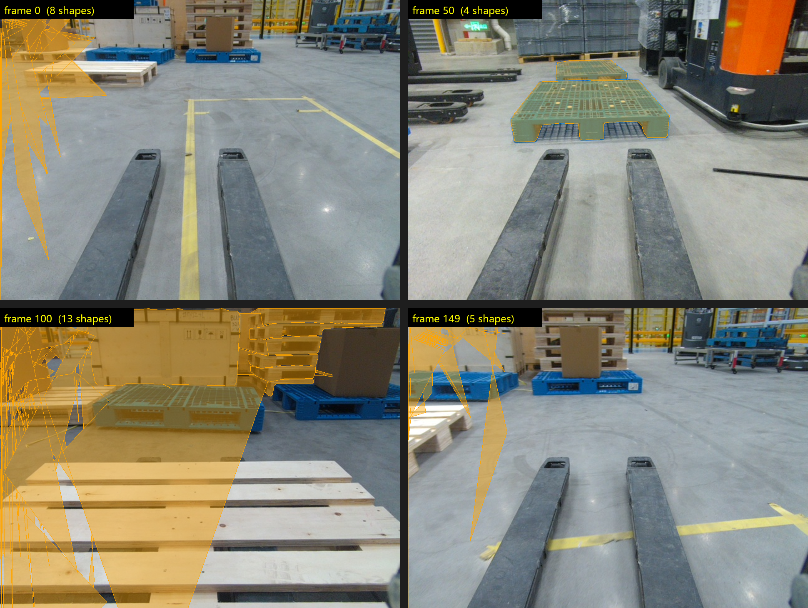

# CVAT 自助标注（自动跟踪）

在自建 CVAT 平台上加装 serverless 自动跟踪（auto-tracking）能力，实现"标一帧、自动跟完全段"，降低视频/多帧标注人力成本。

- 目标平台：CVAT v2.61.0（内网 `http://172.16.88.68:12080`）
- 推理框架：Nuclio（CVAT serverless 函数）
- 跟踪模型：调研中（SiamMask / TransT / SiamRPN++ / NanoTrack / ByteTrack 等，见 `status/model-research.md`）

---

## 1. 架构概览

```
┌──────────────┐   浏览器    ┌─────────────────────────────┐
│  标注人员     │ ─────────▶ │  CVAT UI (172.16.88.68:12080)│
└──────────────┘            │                              │
                            │  CVAT server (Django)        │
                            │      │                       │
                            │      │ invoke function        │
                            │      ▼                       │
                            │  Nuclio / serverless          │
                            │      │                       │
                            │      ▼                       │
                            │  tracker 推理容器 (ONNX/GPU)   │
                            └─────────────────────────────┘

┌──────────────┐   git push   ┌──────────────┐   ssh/deploy   ┌──────────────┐
│  本仓库       │ ──────────▶ │  GitHub       │ ────────────▶ │  目标服务器    │
│  (本地开发)   │             │ cvat-auto-    │               │  172.16.88.68│
└──────────────┘             │  tracking     │               │              │
                             └──────────────┘               └──────────────┘
```

数据流：标注人员在 CVAT UI 选中首帧目标 → 点 Track → CVAT 通过 Nuclio 调用 tracker 函数 → tracker 逐帧输出 bbox/多边形 → 结果回写 CVAT 标注。

---

## 2. 真实任务效果（Task3 / 150 帧）

> 实测任务：Task3（task 430 / job 423，共 150 帧叉车第一视角仓库视频）。



**结论一句话：人工只在 frame 0 标了 8 个 pallet 种子 mask，约 4.6 分钟自动跟踪完全部 150 帧，共产出 492 个 shape、覆盖 116 帧。** 目标托盘出画的帧自动留空，属正常行为。

| 关键帧 | shape 数 | 说明 |
|---|---|---|
| frame 0 | 8 | 人工种子，覆盖全部托盘 |
| frame 50 | 4 | 自动跟踪，mask 贴合塑料托盘 |
| frame 100 | 13 | 场景中多个托盘均被覆盖 |
| frame 149 | 5 | 最终帧托盘 mask 贴合 |

**每个种子实例的生成量**：72 / 78 / 74 / 46 / 62 / 46 / 65 / 50（合计 492）。
完整统计与验证：`results/full-propagation/verification-report.md`、`results/full-propagation/full-propagate-summary.json`。

短范围演示（0-30 帧）对比图见 `results/demo/demo-grid.png`，面板实连截图见 `results/demo/panel-demo.png`。

### 完整工作流：标首帧 → 缓存 → 范围自动跟踪 → 检查

1. **安装面板（二选一）**
   - Tampermonkey：导入 `userscript/cvat-auto-annotation.user.js`；或
   - 浏览器扩展：Edge/Chrome 打开 `edge://extensions` → 开启开发者模式 → 「加载解压的扩展」选择 `extension/` 目录。
2. **打开作业**：在浏览器正常登录 CVAT，打开标注作业页（URL 形如 `/tasks/430/jobs/423`）。
   面板自动复用浏览器已登录会话（sessionid/csrftoken），**无需再次输入账号密码**——
   顶部显示绿色「CVAT:用户名 / SAM3:已连接」即表示就绪。
3. **标首帧**：在 CVAT 里把起始帧（如 frame 0）每个要跟踪的目标标好，按 `Ctrl+S` 保存。
4. **缓存帧**：面板选好标签、填起止帧 → 点「① 缓存帧」，等进度条走到就绪。
5. **范围自动跟踪**：点「② 范围自动跟踪」，确认弹窗后逐实例传播（状态栏实时显示 `实例 n/N`）。
6. **检查**：点「③ 跳转结束帧检查」逐帧核对，错的手动改；后续未覆盖的帧人工补标。

面板其余按钮：传播下一帧、撤销上一步、改标签、删范围（均带二次确认）、提示分割（点/框/文本）。
详细手册见 `docs/overlay-usage.md`。

---

## 3. 目录结构

```
cvat-auto-tracking/
├── README.md                 # 本文件
├── LICENSE                   # 开源许可证（MIT）
├── .gitignore
├── sync-to-github.ps1        # 一键 add/commit/push（带时间戳、幂等）
├── status/                   # 项目状态与调研追踪
│   ├── devops.md             #   DevOps / 仓库运维状态
│   ├── TIMELINE.md           #   里程碑时间线
│   └── model-research.md     #   跟踪模型选型调研
├── docs/                     # 文档与报告
│   ├── CHANGELOG.md          #   每次提交的内容与时间
│   └── reports/              #   阶段性汇报
├── serverless/               # Nuclio tracker 函数源码
│   └── tracker/              #   各模型子目录（function.yaml + main.py）
├── deploy/                   # 部署脚本
│   ├── deploy.ps1            #   Windows 本地发起部署（SSH）
│   └── deploy.sh             #   Linux 服务器端执行（nuctl deploy）
├── tests/                    # 函数本地测试 / 单元测试
└── results/                  # 产物：截图、测试结果、导出文件
```

## 4. 部署快速开始

> 前提：已拿到服务器 SSH 凭据，且服务器已装好 Docker / Nuclio（见 `docs/` 后续部署手册）。

```powershell
# 1. 克隆本仓库
git clone https://github.com/<your-user>/cvat-auto-tracking.git
cd cvat-auto-tracking

# 2. 在本地准备好 tracker 函数（serverless/tracker/<model>/）

# 3. 一键部署到服务器（PowerShell）
.\deploy\deploy.ps1 -ServerHost 172.16.88.68 -SshUser <user> -FunctionDir .\serverless\tracker\<model>

# 4. 在 CVAT UI 中：任务 → 选首帧 → 画框 → Actions → Track 选择该函数
```

## 5. 使用截图（占位）

> 部署完成后替换以下占位：

| 位置 | 截图文件 | 说明 |
|---|---|---|
| 函数在 CVAT `/ui/models` 列表可见 | `results/screenshots/01-function-listed.png` | Nuclio 部署成功后 CVAT 能拉到函数 |
| 首帧标注后点 Track | `results/screenshots/02-track-trigger.png` | UI 触发自动跟踪 |
| 后续帧自动标注结果 | `results/screenshots/03-auto-annotated.png` | tracker 输出回写 |

## 6. 复现步骤

1. 环境：Windows 本地 + Python 3.13；目标 Linux 服务器 172.16.88.68（端口 22 / 12080 已开放）。
2. 服务器侧：安装 Docker、Nuclio（dashboard 端口需打通或做 SSH 端口转发）。
3. 函数侧：参考 CVAT 官方 `serverless/README.md`，在 `serverless/tracker/<model>/` 下放 `function.yaml`（`kind: tracker`）与 `main.py`。
4. 部署：`.\deploy\deploy.ps1 ...`（见上节）。
5. 验证：在 CVAT 已有任务（CS_real 系列等）上选一段视频，首帧标一个目标 → Track → 检查后续帧是否自动跟踪。

## 7. 日常更新（实时入库）

任何新产物（模型配置、文档、测试结果、截图）落到本仓库后，执行：

```powershell
.\sync-to-github.ps1 -Message "说明本次改了什么"
```

脚本会自动：追加 `docs/CHANGELOG.md` → `git add -A` → 带时间戳 commit → push 到 origin。无变更时静默退出，可反复执行。

## 8. 安全说明

- GitHub PAT 仅用于 git/gh 认证，由 Git Credential Manager 保管，**不写入仓库任何文件**。
- 服务器 SSH 凭据同样不入库；如需本地化配置，请放入被 `.gitignore` 忽略的 `.env` / `deploy.local.ps1`。
