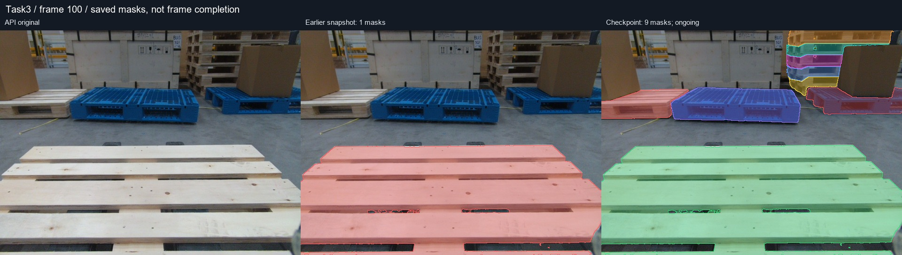

# CVAT 视频帧分割：候选生成、跟踪与独立复核

本仓库保存 CVAT 辅助标注工具、真实任务的中间证据，以及可迁移到新任务的审核与增量写入流程。

**最新本地阶段：[Task3 第42批图文报告](docs/reports/2026-10-26-task3-batch42.md)**

[早期204个mask固定快照](docs/reports/2026-10-26-task3-reviewed-workflow.md)继续保留。



## 当前状态

Task3 对应 task 430 / job 423，共 150 帧。第42批写后快照保存 **702 个 pallet mask，145 帧非空**；42批共 **678 次回读验证操作，606次新增、72次更新**。全图 pallet 查漏仍在进行，其余六类尚未写入。公开发布已获授权，但 GitHub 凭据写入返回403；用户选择稍后处理，新增材料目前只保存在本地分支。

这些数量不表示准确率、召回率或完成率。旧版“492 个 shape / 116 帧”记录的是历史传播产出；发现错分、合并、漏标后，已撤回将其视为整段质量验收的结论。旧产物保留用于追溯。

## 从这里开始

| 需要 | 入口 |
|---|---|
| 看原图、补标前后、失败案例与操作账本 | [最新第42批报告](docs/reports/2026-10-26-task3-batch42.md)、[第35批报告](docs/reports/2026-10-26-task3-batch35.md)、[最初报告](docs/reports/2026-10-26-task3-reviewed-workflow.md) |
| 在新 task/job 上复用流程 | [workflow 工具与命令](workflow/README.md) |
| 检查保存状态与每批实际写入 | [机器可读快照](results/reviewed-workflow/2026-10-26-batch42/checkpoint.json)、[操作账本](results/reviewed-workflow/2026-10-26-batch42/operation-ledger.json) |
| 核对图像、源帧顺序及证据哈希 | [图像绑定](results/reviewed-workflow/2026-10-26/image-bindings.json)、[时序清单](results/reviewed-workflow/2026-10-26/sequence-manifest.json)、[产物 SHA256](results/reviewed-workflow/2026-10-26/asset-manifest.json) |
| 使用已有浏览器辅助面板 | [历史面板使用说明](docs/overlay-usage.md) |

## 可复用工作流


当前验证过的候选路线为本地双向光流辅助 + SAM2 提示分割精修。服务发现中有 SAM2 interactor，没有确认可用的原生 CVAT `kind: tracker`。不能把提示分割的速度或候选数量当作已部署的视频跟踪质量。

- 候选生成与远程写入分开；默认只生成计划。
- 作者与复核者分别检查实例身份、边界、遮挡、全图漏标。
- 所有候选绑定原图和元数据；逻辑帧号不能替代真实时间顺序。
- 一个自动写入者；目标帧内容改变就跳过，避免覆盖手工编辑。
- 每次只提交一个已批准 shape，再回读验证。未知写入结果先查明，不盲目重试。
- GitHub 每次固定一个快照，区分候选、审核、写入和整体完成。

## 目录

```text
workflow/                         可配置复用工具、示例配置、离线测试
results/reviewed-workflow/         新流程的图像、RLE、账本与固定快照
docs/reports/                    图文报告与离线报告构建器
extension/、userscript/            历史浏览器面板
serverless/、deploy/               原有服务部署材料
results/full-propagation/          历史传播产物，未作为验收真值
```

复用配置不包含内部地址、个人路径或凭据。访问认证按 [workflow 文档](workflow/README.md) 从环境变量提供。旧面板、旧传播脚本的写入能力与新审核流程不同，使用前应明确目标任务和作用范围。
