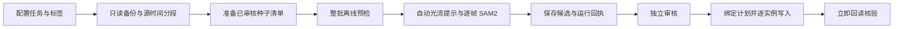
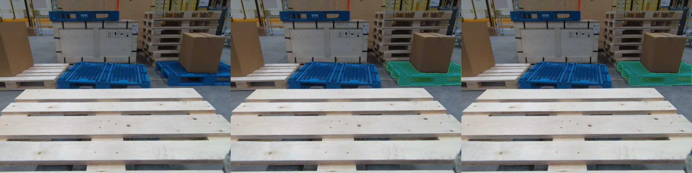
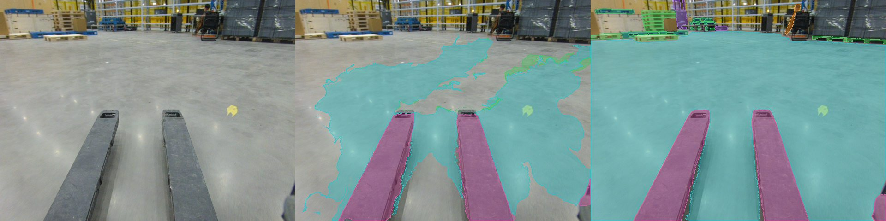

# 自动标注工具包：批量运行与走向零人工

目前可以一次提交多个已审核种子，让程序连续完成同片段传播、逐帧 SAM2 精修、候选落盘和前后状态核对。新增的批量入口不再需要逐个实例执行命令。它仍然输出待审核候选；自动发现全部新目标、自动语义验收和无人值守提交尚未接通。

Task3 的最终 1,550 个 mask 保持不变。本次工具改进和离线实验没有写入 CVAT。

## 当前可执行的流程



定位和审核可由人或 Agent 执行，但现有程序不会根据一项数值检查自动冒充完成语义审核。`source=auto` 也不代表没有人工参与。

## 批量候选生成

先按 [workflow 使用说明](../workflow/README.md) 配置并取得稳定基线、原图和种子审核文件。复制 [batch.example.json](../workflow/batch.example.json)，每项指定类别、种子帧、mask、审核文件和最多 25 个后继帧，建议每段 8 帧。种子文件路径相对于清单所在目录。

```bash
# 完全离线：所有实例先预检，无认证请求、无推理、无标注写入
python -m workflow.batch --config workflow/config.local.json --baseline workflow/work/baseline --manifest workflow/batch.local.json

# 明确启动整批推理：只生成候选，不提交标注
python -m workflow.batch --config workflow/config.local.json --baseline workflow/work/baseline --manifest workflow/batch.local.json --out workflow/work/batch-001 --run
```

认证只使用 `CVAT_TOKEN`，或 `CVAT_USERNAME` / `CVAT_PASSWORD` 环境变量。不要从历史脚本、聊天或报告中提取账号密码。

批量入口会检查全部种子后才开始第一项推理，检查类别白名单、种子摘要、源图绑定、真实序列和人工保护帧。重复实例键会被拒绝。运行按实例串行，避免配置切换和服务争用；种子之间不共享写入权限。一个实例漂移时停止该实例，继续下一项；HTTP 等异常则停止整批，不自动重试。完成回执为 `batch-summary.json`。

输出状态区分：

| 状态 | 含义 |
|---|---|
| `OFFLINE_BATCH_DRYRUN` | 本地校验通过，未开始网络调用 |
| `CANDIDATES_READY_FOR_REVIEW` | 已生成候选，尚未审核或写入 |
| `FINISHED_WITH_STOPPED_INSTANCES` | 部分实例因质量检查提前停止 |
| `STOPPED_ON_ERROR_NO_AUTOMATIC_RETRY` | 遇到异常，保留已产生结果，未重试 |

中断后先查看回执，用新输出目录和只含未处理项的新清单继续；不要反复运行同一输出目录。审核及写入仍使用原有 `bind`、`plan` 和显式 `--apply`，不跳过已有防并发覆盖和回读检查。

## 一个已经实际跑通的案例

历史运行中，第 104 帧右侧蓝托盘作为种子，连续生成 106、108、110、112、114、116、118、120 共 8 帧候选，推理阶段耗时 **10.513 秒**。这 8 个候选与最终保存的对应 mask 像素完全一致，说明该具体实例的候选曾经审核后直接采用。

下面为第 106 帧：左侧原图，中间历史 SAM2 候选，右侧最终保存的对应实例。



这是历史推理证据回放，本轮未重新联网调用 SAM2。最终参考可能本来就采用了这些候选，不能把一致性当作独立测试集准确率，也不能据此保证其他托盘同样可靠。[回放记录](../results/automation-demo/2026-10-27/sam2-replay.json)

## 新增：离线自动传播评测

使用已有审核标注作为固定参考，指定种子间隔，让程序预测非种子帧，再做同类别一对一匹配。参考只在种子帧进入预测；非种子帧只用于评分，不能偷偷修正预测。无需 CVAT 登录或模型服务。

```bash
python -m workflow.benchmark_propagation --annotations path/to/saved-annotations.json --sequence path/to/sequence-manifest.json --frames path/to/frames --out path/to/new-benchmark --keyframe-intervals 8 10000
```

默认图片名为 `frame_api_{frame:03d}.jpg`，可用 `--frame-pattern` 修改。序列文件需提供 `runs`，每项包含 `run_id` 和真实时间顺序的 `frames`。输出包括源图摘要、按类别和帧统计、候选预览与 `benchmark.json`。`10000` 在本例表示每个不足 10,000 帧的片段只取首帧种子；不是通用的“永远不重新取种子”开关。

本轮覆盖 Task3 四个连续片段、150 帧。**这是纯 DIS 光流对照实验，没有运行 SAM2 精修，不能代表完整流程的质量。** 在本机 Python 3.14 / OpenCV 5.0.0 / NumPy 2.5.3 环境，传播与输出阶段共 15.711 秒；不包含预先解码参考、服务启动、人工操作或标注写入时间。

| 策略 | 提供种子的帧数 | 被预测帧数 | 达到 IoU≥0.85 的参考实例匹配 |
|---|---:|---:|---:|
| 每 8 帧提供审核种子 | 20 | 130 | 518 / 1,343（38.6%） |
| 每段仅首帧提供种子 | 4 | 146 | 256 / 1,511（16.9%） |

匹配采用同类别、按 IoU 降序的贪心一对一分配；未建立独立的跨帧物理身份真值。种子帧不进入上述分母。这是与既有审核快照的一致性，不是独立测得的最终准确率。

按光流可靠性及面积变化筛选后，第一策略留下 580 个候选，其中 445 个达到匹配标准（76.7%）；剩余 135 个仍不满足标准。数值“稳定”不等于类别、实例身份和全图覆盖正确。



左为原图，中为从第 75 帧种子传播的候选，右为审核参考。新出现的机器人、人物和托盘不会由纯传播自动发现。[完整评测记录](../results/automation-demo/2026-10-27/benchmark.json)

## 零人工运行需要补齐什么

目标定义为“用户不再逐帧找对象、点选、修边”，不能等同于“任何视频均零错误”。可执行工具和待实现能力需分开记录：

| 环节 | 当前工具 | 面向零人工的后续能力 |
|---|---|---|
| 建立种子 | 已审核 mask、点提示 | 全图类别识别与实例分离，自动生成种子 |
| 后续帧传播 | DIS 提示 + 逐帧 SAM2 | 带视频记忆的模型或逐帧自动重检测，识别新入画对象 |
| 错误检查 | 结构、重复、漂移、源图绑定 | 独立模型语义检查、跨视角一致性和类别覆盖检查 |
| 失败处理 | 停止该实例或该批次，留下回执 | 自动换提示、局部重分割、换模型；限制重试次数 |
| 接受与写入 | 双审绑定、单写入者、逐项回读 | 在独立留出片段上校准接受规则，再明确启用自动提交 |

候选模型路线可考虑 SAM3 的文本/示例提示全图分割与视频预测能力；它的官方仓库提供相关示例，但本工具包没有宣称已安装或接通。CVAT 的 SAM2 视频 Tracker 与当前逐帧 interactor 是不同部署路径，需核对实际版本和模型能力。

不能只靠同一模型自评来宣布全部完成。若自动重试后仍有未决实例，系统可以在无人值守模式下导出它们，但必须把该任务标为未全部验收；“不让用户操作”和“掩盖未完成”应严格区分。

本数据只有四段高度相关的短序列。后续模型训练/阈值选择应按连续片段或独立视频划分训练、校准和留出集，不能随机拆相邻帧后报告泛化效果。现有 1,550 个 mask 可以作为启动数据，仍应复核其适用范围。

## 验证与来源

工具包共 **38 项离线测试通过**，包括新加入的目标帧参考不泄漏进预测、重复候选不重复计分、默认批处理不联网、清单后项非法时首项不启动、异常停队列且不回显敏感错误。新批量入口尚未完成真实服务的端到端调用验证。

- [可运行批量模块](../workflow/batch.py)、[离线评测模块](../workflow/benchmark_propagation.py)、[测试](../workflow/tests/test_batch_benchmark.py)
- [Meta SAM3 官方代码与示例](https://github.com/facebookresearch/sam3)
- [CVAT SAM2 Tracker 官方文档](https://docs.cvat.ai/docs/annotation/auto-annotation/segment-anything-2-tracker/)

本轮在线旧读取脚本被自动审批拦截，原因是从非标准历史文件读取硬编码凭据；未绕过该限制。本文新增评测完全离线，后续在线运行应走上文标准环境变量认证。
