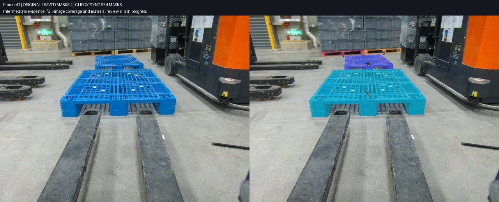
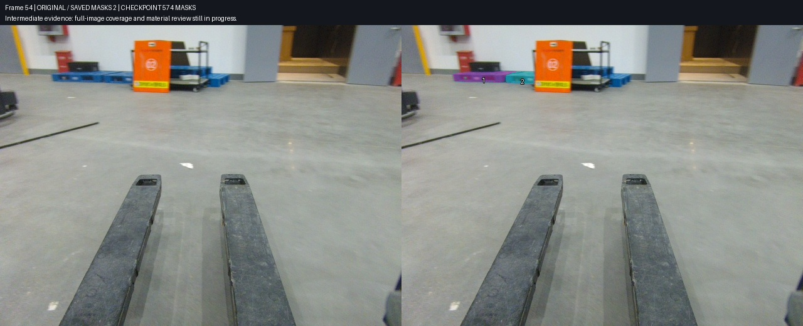
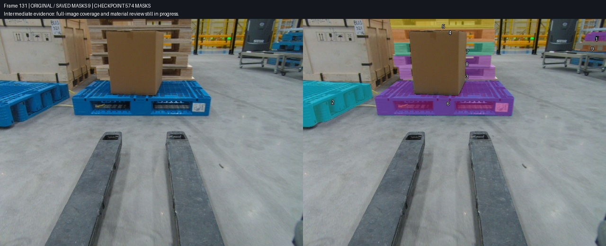
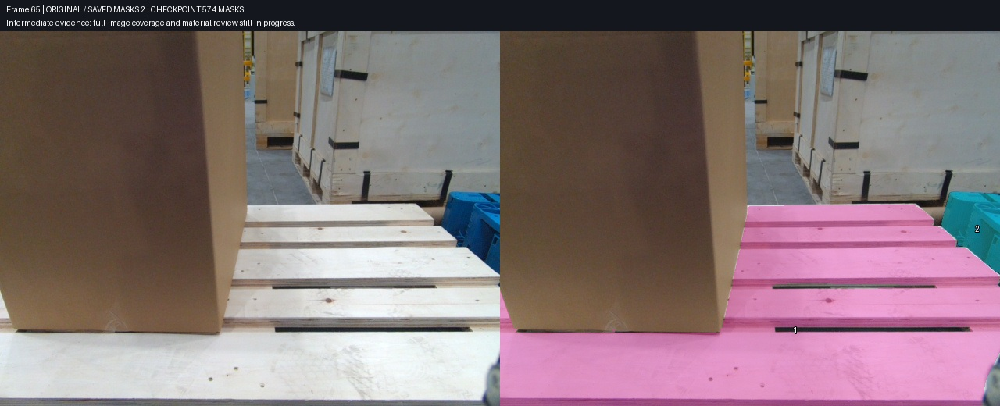

# Task3 全图托盘补标与独立复核记录

本阶段固定在第 35 批写后回读，时间为 2026 年 10 月 26 日上海时间 19 时 33 分之后。Task3 对应 task 430 / job 423，共 150 帧；该快照保存 **574 个 pallet mask，121 帧非空**。35 批共验证 **550 次操作，其中新增 478 次、更新 72 次**。已保存实例包括 81 个人工来源和 493 个自动来源；来源字段不等于质量等级。

全图 pallet 查漏仍在进行，其余六类尚未写入，本阶段不报告完成率或准确率。[机器可读快照](../../results/reviewed-workflow/2026-10-26-batch35/checkpoint.json)与[完整操作账本](../../results/reviewed-workflow/2026-10-26-batch35/operation-ledger.json)固定了相同状态。最初的 [204 mask 图文快照](2026-10-26-task3-reviewed-workflow.md)保持原样，便于比较。

公开发布已经得到用户授权；实际 Git 推送和连接器写入均返回 403。用户选择稍后处理凭据，当前新增材料保存在本地发布分支，没有成功上传或创建 PR。

## 全图覆盖与实例身份

用户确认：**只标可辨识的独立托盘，运输木箱自带的一体底座不计入 pallet。** 灰色塑料周转箱下的独立木托盘仍然属于目标，不能因货物颜色相近而排除。

下图第 41 帧包含前后两块蓝托盘，以及远处塑料箱下左右两块木托盘。两个木托盘根据独立端脚、面板与接缝分开，货物本身被排除。原先 SAM 把相邻木托盘合并，最终改为逐帧核对可见木板与叉孔，再由另一名审核者检查。



第 54 帧展示“已补部分”与“全图完成”的差别：左侧载黑箱蓝托盘和相邻空蓝托盘已分别保存，橙色标牌右侧的远景蓝盘仍须继续补标。初次二审还发现两盘接缝漏掉一个蓝色楔形区域，作者依据原图补回左盘后右角 51 像素，独立复核后才写入。



第 131 帧左侧运输木箱的支脚与箱体一体，按用户定义排除。画面中央载纸箱蓝托盘、后方逐层木托盘、左边截断蓝盘、右侧上方货架蓝盘分别标注。货架下层蓝盘在这个快照里仍待暗内壁修正和独立复核，不能因已有 9 个实例就宣布全图完成。



## 边界返修的具体依据

第 65 帧右侧蓝托盘被前景木托盘遮挡，蓝色台阶状区域仍属于同一个物理托盘。SAM 漏掉了与图像右边缘相连的蓝色材料；这类漏区不会被“仅填闭合孔洞”的脚本发现。61、63、65 帧分别补回原图确认的 8、50、30 像素，再检查对比图和差异图，没有按颜色无差别填孔。



孔洞处理分三种情形：可确认的地面、货架或黄绿色背景从 mask 中排除；托盘自身的暗内壁、格栅和印字保留；材质无法确认的窄白条记录为待判断并暂时保留。133、146 帧上架蓝盘脚边的白条属于第三种情况，其存在不影响记录已确认的主体，但阻止相关边界被宣布最终验收。

早期只排除黄色孔洞的规则不够完整，后续发现木托盘叉孔中也有灰、白、蓝背景。第 22、24 批分别修正 15、38 个已有实例，保留对象身份和其他字段。审核不能只盯新增对象，还要追查旧候选中系统性错误。

## 后续批次账本

第 1–12 批见首份图文报告；以下每个数字均来自实际成功回读的操作，而非候选队列数量。

| 批次 | 新增 | 更新 | 主要工作 |
|---|---:|---:|---|
| 13 | 15 | 0 | 灰箱下独立木托盘与相邻实例接缝 |
| 14 | 24 | 0 | 早期冻结候选逐项复核后写入 |
| 15 | 38 | 0 | 125–133 帧木垛逐层实例 |
| 16 | 10 | 0 | 用户释放的 17、19、21、23 帧增量补标 |
| 17 | 63 | 0 | 134–145 帧木垛及遮挡 |
| 18 | 3 | 0 | 三个冻结候选返修后补入 |
| 19 | 19 | 0 | 后方蓝盘及载货木盘 |
| 20 | 25 | 0 | 91、93、95 上架蓝盘与后段木垛 |
| 21 | 10 | 0 | 后段地面及边缘托盘 |
| 22 | 0 | 15 | 125–133 木托盘叉孔背景修正 |
| 23 | 11 | 0 | 上方、货架及边缘遗漏 |
| 24 | 0 | 38 | 100–124 木托盘叉孔背景修正 |
| 25 | 16 | 0 | 1–15 奇数帧后方两块蓝盘 |
| 26 | 4 | 4 | 返修木盘、蓝盘及释放帧孔洞 |
| 27 | 14 | 0 | 0–12 偶数帧地面两块蓝盘 |
| 28 | 16 | 0 | 101–121 部分奇数帧后蓝盘 |
| 29 | 6 | 0 | 111、113、123 后蓝盘与材质判断 |
| 30 | 3 | 0 | 50 帧后蓝盘与两块载货木盘 |
| 31 | 11 | 0 | 纠正 SAM 提示点后补木盘与边缘盘 |
| 32 | 10 | 0 | 37–48 所属连续片段后蓝盘 |
| 33 | 4 | 0 | 33、35 帧橙色标牌前两个独立蓝盘 |
| 34 | 35 | 0 | 15 个箱顶或右侧蓝盘与 20 个独立木盘 |
| 35 | 33 | 0 | 23 个货架可见实例及 10 个远处蓝盘 |

## 可复用的协作与审核方式

采用三个候选作者按帧段分工，审核者交叉检查其他作者的产物，主控负责唯一的远程写入口。独立审核凭证绑定冻结候选包 SHA256、原图 SHA256、逐实例通过或暂缓结论。主控验证这些证据及掩模交叠，再提交增量；不会把主控没有逐图看的项目写成“主控已逐图审核”。

每次返修生成新版本，保留旧候选、原图、修后叠加图和像素差异。写入计划绑定实际批准的版本，未通过的对象从该批中排除。保存后逐项回读，并验证无关实例保持一致。

[通用工具和命令](../../workflow/README.md)与[逐帧覆盖示例](../../workflow/coverage.example.json)可迁移到后续任务。建议按以下顺序执行：

1. 绑定 task、job、标签、帧范围，备份标注和原图哈希。
2. 按源时间分片，核对不同视频混排，禁止按逻辑帧号盲目跟踪。
3. 每个片段挑选种子，检查物理实例数及提示点是否落在目标材料上。
4. 小批传播或 SAM 精修，每项保留源图、mask、叠加图、来源与版本。
5. 独立复核身份、遮挡、边界和全图漏标；返修必须再次绑定新版本。
6. 单写入者逐实例 PATCH，写前比较目标帧哈希，写后回读核验。
7. 每帧保留“已有实例、确认遗漏、身份疑点、材质疑点、全图审核状态”，不拿 shape 数量替代覆盖验收。
8. 固定阶段快照，生成图文与机器账本，再推进下一批。

当前实际使用的是光流辅助提示点传播与 CVAT 同源 SAM2 interactor，尚未确认原生 CVAT tracker 可用。跨帧模板只有在连续片段与实例身份得到核对时才复用；跟踪自一致性指标不能替代原图二审。工具包的 32 项离线测试与任务专用脚本的真实写入记录分别保留，不混淆测试范围。

## 复现与剩余工作

本阶段图像均从最终回读的 masks 渲染。显示编号落在实际 mask 像素上，避免编号落在被排除的货物中造成误解。四张对照图均已查看，图文绑定及文件校验值见 [图像清单](../../results/reviewed-workflow/2026-10-26-batch35/image-bindings.json)与 [SHA256 清单](../../results/reviewed-workflow/2026-10-26-batch35/asset-manifest.json)。

构建器只读取明确指定的本地证据，不联网、不修改标注，也不读取身份验证文件：

```powershell
python docs/reports/tools/build_followup_checkpoint.py --evidence-root <本地证据目录> --through-run plan_20261026T113312320660Z --tag 2026-10-26-batch35 --frames 41 54 65 131
```

剩余重点包括前段木垛和货架、中段尚无标注的清晰托盘、远处橙色标牌群，以及货架暗内壁和窄白条的判断。完成 pallet 全图查漏后，再推进 person、floor、slope、ego、other_robot、cargo_floor，并进行跨帧身份与全类别验收。
