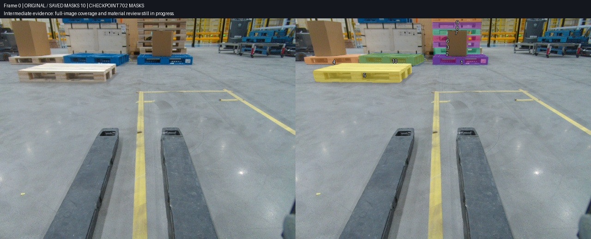
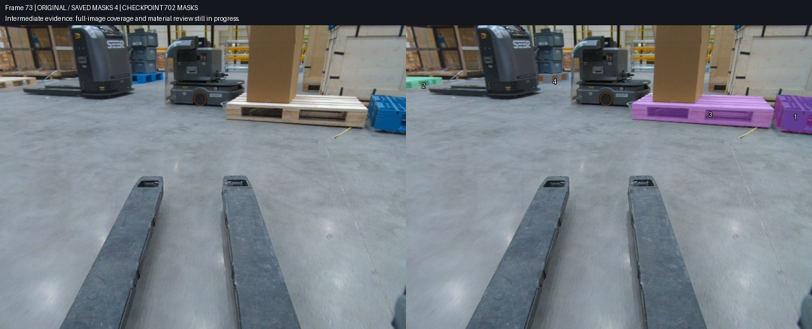
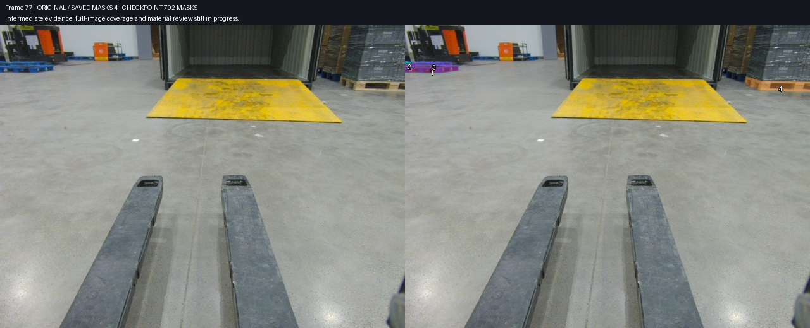
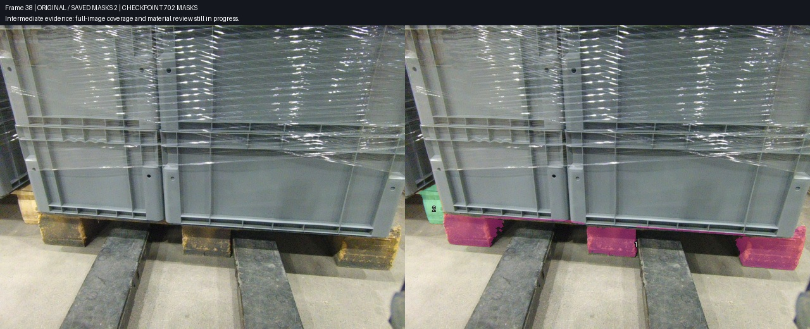

# Task3 第 42 批：全图补标、逐层分盘和双向退回审核

本记录固定在 2026 年 10 月 26 日第 42 批最终回读：**702 个 pallet mask，145 / 150 帧有标注**，包含 81 个人工来源、621 个自动来源。42 批累计回读验证 678 次操作，其中新增 606 次、更新 72 次。所有数字来自保存后的标注和操作凭证，不能解释为召回率、准确率或完成率。

Task3 的实际接口为 task 430 / job 423。全图 pallet 查漏仍在进行，其余 person、floor、slope、ego、other_robot、cargo_floor 六类尚未写入，**全类别完成帧数仍为 0**。[固定快照](../../results/reviewed-workflow/2026-10-26-batch42/checkpoint.json)、[全部已保存 masks](../../results/reviewed-workflow/2026-10-26-batch42/saved-annotations.json)和[42 批操作账本](../../results/reviewed-workflow/2026-10-26-batch42/operation-ledger.json)绑定同一状态。之前的 [574 mask 阶段记录](2026-10-26-task3-batch35.md)与[最初 204 mask 记录](2026-10-26-task3-reviewed-workflow.md)保留不变。

用户已授权公开发布；GitHub 实际写入返回 403，用户选择稍后处理权限、先继续标注。本阶段在本地发布分支准备，尚未成功推送，也没有 PR。

## 堆叠实例必须逐层确认

第 0、2、4、6、8、10、12 帧各有六层可辨识的独立木托盘，最上层被画面截断。纸箱遮住下方四层中部；同一托盘左右断开的可见部分仍属于一个实例。七帧共补入 42 个 mask。



这一批由主控制作候选，另一位审核 Agent 独立检查。第一版对叉孔作矩形扣除，但审核者指出棕色、暗色区域可能是后方木板或内部材料，缺乏可确认的外部背景证据，因而退回。第二版恢复了 11,023 个像素，仅排除可确认的黄色护栏和连续灰蓝背景小窗；没有因颜色偏暗就挖空。七张原图及新版对照逐张复核后，才写入 42 个实例。第一版从未写入，旧版本与退回记录仍保留。

这也说明通过审核不等于所有暗部材质都已确定。不明确的内部材料保留并记录，后续有新视角证据时可以保持同一对象 ID 做局部修正。图中上方蓝盘和右侧货架仍有遗漏，不能把本批的十个已保存实例当作全图完成。

## 单项不通过时，其余通过项继续推进

第 71、73、76、79 帧蓝盘候选由另一位 Agent 独立复核九项；木盘则由主控逐项查看原图与叠加图。八项木盘中七项通过，第 76 帧右边缘木盘的外侧凹口可能包含与地面连续的灰区，单独暂缓，不随其余对象一起写入。



随后作者和审核者核对原生像素，只收回能确认是地面的小灰芯，保留可能属于木侧板的长条。该 13 像素修版已完成主控查看，但尚不属于本报告固定的 702-mask 快照。必须把“候选修好”与“实际写入”分别记录。

## 远景蓝盘不能沿用 SAM 合并结果

第 77、80、83、86 帧左侧各有前方载灰薄板蓝盘、后中蓝盘，以及大部分出画的后左蓝盘。SAM 曾把后排不同实例合并；最终结合相邻视角确认三个物理托盘，排除灰色货物和竖直遮挡物，同时保留遮挡物下方实际可见的蓝支脚。



四帧共补入 12 个蓝盘与四个载包裹木盘。主控逐张查看四张三色蓝盘对照和四张木盘细节图。暗叉孔、浅色内部条纹中尚不能确认材质的部分留有待审说明，不能写成背景已被证明。

## 遮挡不等于没有目标

第 36、38 帧的前景主木托盘已经保存，但左邻托盘仍露出木板与端脚。新增实例只覆盖这些可见部分，并标记被遮挡。接缝处各九个像素归已保存的前景主托盘，新增实例不再重复占用。



用户已明确：只标可辨识的独立托盘，运输木箱自带一体底座不算。这里的塑料周转箱下方是独立木托盘，因此应标；不能把所有“箱子下面的木结构”一概排除。

## 第 36–42 批账本

| 批次 | 新增 | 更新 | 通过并回读的内容 |
|---|---:|---:|---|
| 36 | 12 | 0 | 货架下层九项、130 上层背景修正、131/132 下层暗内部材料恢复 |
| 37 | 5 | 0 | 64 后方两盘、66 前后共三盘 |
| 38 | 4 | 0 | 18/20/22/26 塑料箱下主木托盘 |
| 39 | 23 | 0 | 68/70/72/74 房间蓝盘十二项、橙牌旁左中蓝盘十一项 |
| 40 | 8 | 0 | 24/28/30/32/34/36/38 主木盘、115 远蓝盘三像素返修 |
| 41 | 58 | 0 | 七帧逐层木垛四十二项、71/73/76/79 蓝九项及木七项 |
| 42 | 18 | 0 | 77/80/83/86 蓝十二项及木四项、36/38 左邻木两项 |

这些批次中的“返修”发生在尚未写入的候选上，所以账本动作仍为新增；它们不能误记为已保存对象的更新。

## 可复用的执行约束

1. 按源视频和时间连续性划分传播片段，逻辑帧号相邻不保证同一视频连续。
2. 每个物理实例保留原图哈希、帧文件名、mask、叠加图、版本及作者结论。
3. 由另一位审核者复核；主控本人制作的候选也必须接受外部审核和退回。
4. 材质判断依据原图结构和跨视角证据；禁止整批按黑、白或亮度阈值挖孔。
5. 冻结通过版本和审核凭证哈希，只从通过子集建立增量计划，暂缓项不搭车。
6. 单一写入者逐形状 PATCH，写前检查整帧状态，写后回读目标和无关对象；人工改动会使对应帧停止，不能整任务 PUT 覆盖。
7. 统计候选、已保存、二审通过、全图覆盖和全类别完成五种不同状态，禁止互相替代。
8. 以明确最后一批生成不可混淆的阶段记录，随后继续下一批。

实际使用的是同源 CVAT SAM2 interactor 与光流辅助提示点传播，原生 CVAT tracker 尚未确认可用。豆包历史候选可以作为输入，但本阶段未取得新的可靠桌面交互证据，不能称为豆包实时审核。参与本阶段的三个审核/候选 Agent 与主控具有独立职责；远程标注始终只有主控写入。

[通用工作流](../../workflow/README.md)与[覆盖清单示例](../../workflow/coverage.example.json)提供复用入口。构建本报告快照的命令为：

```powershell
python docs/reports/tools/build_followup_checkpoint.py --evidence-root <本地证据目录> --through-run plan_20261026T123503785002Z --tag 2026-10-26-batch42 --frames 0 73 77 38
```

四张图都来自最终回读 masks，主控已查看原图和保存结果，绑定见[图像清单](../../results/reviewed-workflow/2026-10-26-batch42/image-bindings.json)及[文件哈希](../../results/reviewed-workflow/2026-10-26-batch42/asset-manifest.json)。仍需处理早段上方/货架托盘、16/31 空帧、中段木垛、远景橙牌群与材质疑点；待 pallet 全图检查完成，再推进六类分割和跨帧验收。
