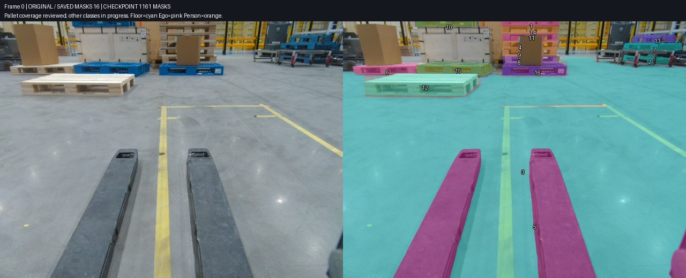
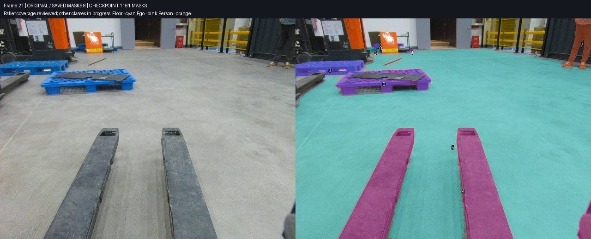
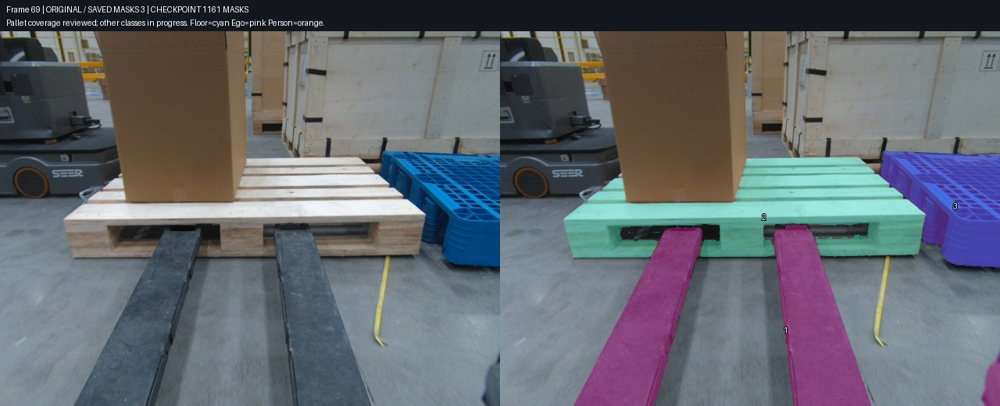
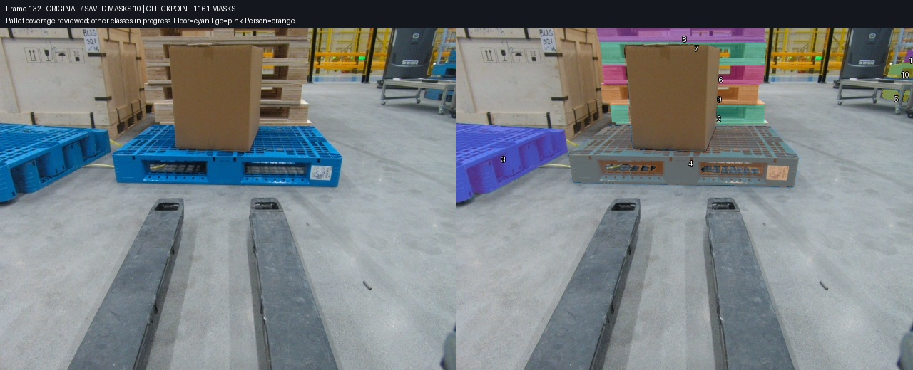
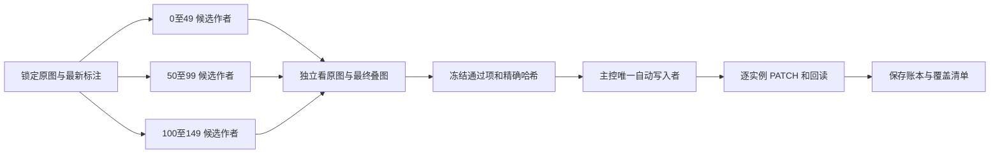

# Task3 第 57 批：全图托盘覆盖完成，继续六类分割

本报告固定在 **2026-10-26 第 57 批最终回读**：Task3 / task 430 / job 423，共 150 帧，保存 **1,161 个 mask**。其中 **1,006 个 pallet** 已完成本轮全图实用覆盖审核；其余类别继续推进，尚未宣布全部类别验收完成。

这份记录只描述固定快照。随后生成的候选、通过的审核和新写入结果不回填到本页数字。依据为[状态快照](../../results/reviewed-workflow/2026-10-26-batch57/checkpoint.json)、[已保存标注](../../results/reviewed-workflow/2026-10-26-batch57/saved-annotations.json)、[57 批操作账本](../../results/reviewed-workflow/2026-10-26-batch57/operation-ledger.json)和[托盘覆盖记录](../../results/reviewed-workflow/2026-10-26-batch57/pallet-coverage-review.json)。

用户已授权公开材料，但 GitHub 实际写入返回 403，用户选择暂缓处理权限、继续标注。**本报告在本地准备，尚未推送成功，也没有创建 PR。**

## 保存状态与覆盖状态分别统计

| 项目 | 本次快照 | 解释 |
|---|---:|---|
| 已保存 mask | 1,161 | 1,080 个 auto 来源、81 个 manual 来源；来源字段不代表是否经过审核 |
| 非空帧 | 150 / 150 | 每帧至少有一项，不等于每帧七类均完成 |
| 回读验证操作 | 1,143 | 1,065 次新增、78 次更新，共 57 批 |
| pallet | 1,006 | 150 帧全图实用覆盖审核完成；27、29 帧未见可辨识托盘 |
| ego | 100 | 第 0–99 帧各一个自机实例 |
| floor | 50 | 第 0–49 帧各一张可见地面 mask |
| person | 5 | 第 21、23、25、27、29 帧各一人 |
| slope / other_robot / cargo_floor | 0 | 本快照尚未写入；不能由零数量推断全段没有目标 |
| 全类别验收完成帧 | 0 | 继续完成其他类别和最终交叉检查 |

托盘三段的已保存数量为 **0–49：275，50–99：320，100–149：411**。三位作者分别对完整原图盘点，主控或独立审核者检查候选叠图，按最终保存状态核对已交实例，已无明确未处理的可辨识托盘缺口。这是本任务当前精度要求下的覆盖结论，未通过额外真值集测量准确率或召回率，也不保证绝无残余错误。

少量无法证明为独立托盘的边缘像素仍按规则排除，例如 50、62 帧极左蓝角和 79 帧与箱体相连的远木条。排除理由保存在覆盖记录中；不为凑数量虚构实例。

相比[第 42 批](2026-10-26-task3-batch42.md)的 702 个 mask，本阶段新增保存 459 个，另做 6 次保留对象 ID 的更新。原先的 [204 个 mask 报告](2026-10-26-task3-reviewed-workflow.md)及历史“492 shapes”产物保留为阶段记录，不能替代这次覆盖审核。

## 四张实际保存状态图

每张图左侧为锁定 API 原图，右侧为本快照已经保存的 mask。颜色用于区分对象或类别，不能用颜色数量判断物理实例。主控实际查看了这四张图并确认原图与保存状态对应；[图像绑定](../../results/reviewed-workflow/2026-10-26-batch57/image-bindings.json)逐张记录源图 SHA、输出图 SHA 和展示的 shape ID。

### 第 0 帧：近处、远处、堆叠与货架都纳入盘点



该帧保存 14 个独立托盘、1 个 ego 和 1 个 floor，共 16 项。早期只处理近处托盘会漏掉后方木垛、箱顶蓝盘和右侧货架的多个物理层。堆叠按实际层数分实例，遮挡后露出的两端可以属于同一层。地面包括黄色标线和阴影，纸箱、托盘和叉臂保持排除。

### 第 21 帧：托盘、地面、自机与人物分开



该帧保存 5 个 pallet、1 个 ego、1 个 floor、1 个 person，共 8 项。人物只标可见身体，不把周围地面纳入；画面截断本身不等同于被实体遮挡。后方和左侧的其他机器人仍在后续类别队列中，因此这张图不是七类最终结果。

### 第 69 帧：已写入自机，地面和其他机器人继续处理



该帧此时保存 2 个 pallet 和 1 个 ego。地面、其他机器人尚未包含在这个固定快照内。这里明确展示进度边界，避免把“有标注”或“托盘找齐”写成全部类别完成。

### 第 132 帧：保留物理层和遮挡关系



该帧保存 10 个 pallet，其他类别仍在进行。载货蓝盘、木垛每层、货架蓝盘分别识别，灰色运输木箱自身连续箱板和一体支脚不被另算成托盘。图像中的纸箱、货物与机械结构也不能因为贴着托盘而一并纳入。

## 七类语义与用户最终精度要求

| 标签 | 采用口径 |
|---|---|
| 201 pallet | 全图所有可辨识的独立托盘；远处、画面边缘、局部遮挡及堆叠各层都检查。同一物理托盘的多个可见岛归同一实例。运输木箱一体底座排除，塑料周转箱下清楚独立的木托盘保留。 |
| 202 person | 每个人一个实例，覆盖可见身体、手和鞋；不补被遮挡或出画部分。 |
| 203 floor | 可见仓库地面，每帧一张语义 mask；包含标线、阴影和清楚可见的物体间地面，排除实体前景。 |
| 204 slope | 参考任务中的集装箱入口斜坡；不能把普通黄色地面标线当斜坡。 |
| 205 ego | 自机的可见叉臂与边缘车体合为一个物理实例，可包含断开的可见部分。 |
| 206 other_robot | 其他机器人或叉车，按物理车辆分实例；只有叉臂可见的画外车辆也可识别，不与自机合并。 |
| 207 cargo_floor | 集装箱内部可见地板；不是货物顶面，也不是一般仓库地面。 |

用户进一步明确：橙色“02”标牌旁右上带叉孔的蓝结构与右下蓝盘是两个独立托盘；细网格按整体盘面保留，只扣明显大孔；手工实例允许在有原图证据和独立复核后保留 ID 做局部修正。此前的身份暂缓据此解除，不能继续沿用旧假设。

同时调整为实用精度、速度优先：先保证全图实例找齐、类别正确、物理层数正确、明显遮挡和显著边界合理。停止围绕 1–2 个像素、微小孔洞反复返工。深色区域可能是材料或内部结构，不按颜色整批挖空；没有明确背景证据的暗部保留。清楚的大片地面漏区、吞货物、漏门架或把多个实例合并，仍必须修正。

## 三段并行生成，单一写入者保存

三个候选作者按 **0–49、50–99、100–149** 分工，先完成全图 pallet，再分别继续其他六类。分工范围用于避免重复劳动，**不是跟踪时序定义**。跨作者复核、主控制作的候选交其他 Agent 审核，以及只先交通过子集，使生成、审核、写入可以并行推进。



豆包历史候选只在来源、原图绑定和独立复核可验证时复用。桌面调用曾停滞，本阶段没有可靠的新实时协作回执，不能说豆包仍在持续审核。当前关键执行由上述三段作者、独立复核与主控完成。作者的“通过”只表示可交审，不自动等于远端已保存。

第 54–57 批尤其体现类别状态分开管理：

| 批次 | 新增 | 更新 | 本阶段已回读内容 |
|---|---:|---:|---|
| 43–49 | 92 | 0 | 托盘边缘、被遮挡邻盘、早段箱顶和货架等补漏 |
| 50–53 | 212 | 6 | 远景橙牌群、货架和剩余全图托盘；保留 ID 的局部修正 |
| 54 | 50 | 0 | 0–49 ego |
| 55 | 50 | 0 | 0–49 floor |
| 56 | 50 | 0 | 50–99 ego |
| 57 | 5 | 0 | 21/23/25/27/29 person |

## 跟踪加速必须服从真实源时间

150 个逻辑帧混有多个连续采集片段。已有[源时间清单](../../results/reviewed-workflow/2026-10-26/sequence-manifest.json)将它们分为四个保守连续区间，长度分别为 62、20、23、45。不能沿数字邻帧或仅靠奇偶规律直接传播；例如一个真实连续片段含 `100 → 102 → 104 → 106 → 108`，不应插入另一个时间片段的 101 帧。片段身份来自源文件名、时间戳和顺序证据，不仅来自画面相似。

当前服务发现确认的是 SAM2 interactor，未确认已部署可用的 CVAT `kind: tracker`。已使用的方案是本地双向光流移动种子、从前后景生成提示点，再由 SAM2 分割下一帧。它生成候选，不直接改 annotations，也不调用异步全任务自动标注。

光流可靠性或 IoU 通过仍可能换错对象，之前 91→93 曾跳到相邻托盘；75→78 运动过大、125→126 目标出画或视角变化时则停止传播。正确做法是在同源连续片段内传播，遇漂移或出画停止，重新建立种子，最后逐帧核对物理身份。相关反例与时间范围见[最初工作流报告](2026-10-26-task3-reviewed-workflow.md)。候选推理耗时不能冒充完整标注耗时。

## 保留手工成果，也允许有证据地修正

17、19、21、23 帧此前是用户手工编辑区，曾暂缓自动写入；用户完成编辑后允许增量补标，并进一步授权有原图证据、经过双审的同 ID 局部修正。保护状态应由当前授权和新鲜基线决定，不能永久硬编码，也不能将授权理解为整任务覆盖。

写入仍由一个自动写入者执行：读取最新 annotations，检查目标帧内容哈希，备份写前状态，逐 shape 使用 `PATCH?action=create/update/delete`。已有对象局部修正走 update 并保留 ID；同帧无关实例不变。禁止全量 PUT。发现外部编辑、人工新增或 ID 变化则跳过对应帧，重新核对；未知请求结果先回读查明，不能盲目重试。

每一小批最后一个 `step_*/after.json` 才代表该批最终已验证写后状态。运行目录的预检双读不能充当最终结果。当前服务器 version 没有被验证为原子并发锁，因此单写入者、帧哈希与回读是实际防护措施，不应宣称完全消除了竞争窗口。

## 可复用产物与后续验收

[workflow 工具包](../../workflow/README.md)提供配置、候选生成、连续片段约束、独立复核和增量写入流程；[覆盖清单模板](../../workflow/coverage.example.json)把“可见、未见、待定、已交审、已保存”逐帧记录。配置通过环境变量接入认证，不携带本机凭据、内部地址或个人目录。已有 32 项离线测试验证关键保护逻辑；它们不等于对所有 CVAT 版本的真实端到端保证。

本次图像与结构化文件有[SHA256 产物清单](../../results/reviewed-workflow/2026-10-26-batch57/asset-manifest.json)。离线[构建器](tools/build_followup_checkpoint.py)可从授权的本地证据目录生成固定快照：

```powershell
python docs/reports/tools/build_followup_checkpoint.py --evidence-root <本地证据目录> --through-run plan_20261026T151314941838Z --tag 2026-10-26-batch57 --frames 0 21 69 132 --pallet-coverage-complete
```

构建不调用远端，也不写标注。重新生成后，图像复核字段应先保持 pending；实际看过输出图、核对其绑定后才能记录通过，并刷新产物哈希。不能复制旧版的通过结论到新图。

后续继续其余类别的全图可见实例盘点与小批写入，核对 floor 和前景的明显交界，处理其他机器人可见组件与身份，逐帧记录确实没有目标的类别。只有七类都完成对应检查、全部通过项已保存回读，才报告整任务完成。发布权限处理与标注推进分开，本报告不把本地文件准备描述成 GitHub 发布成功。
