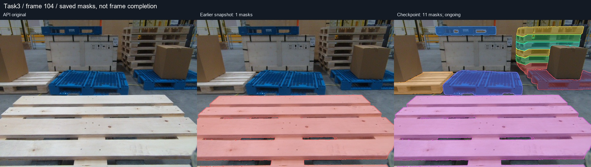
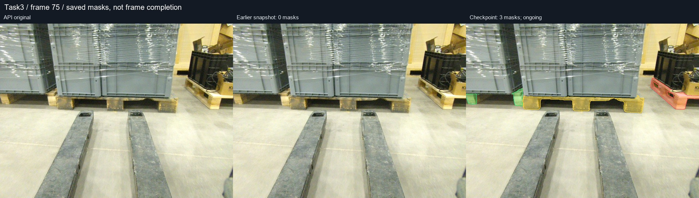
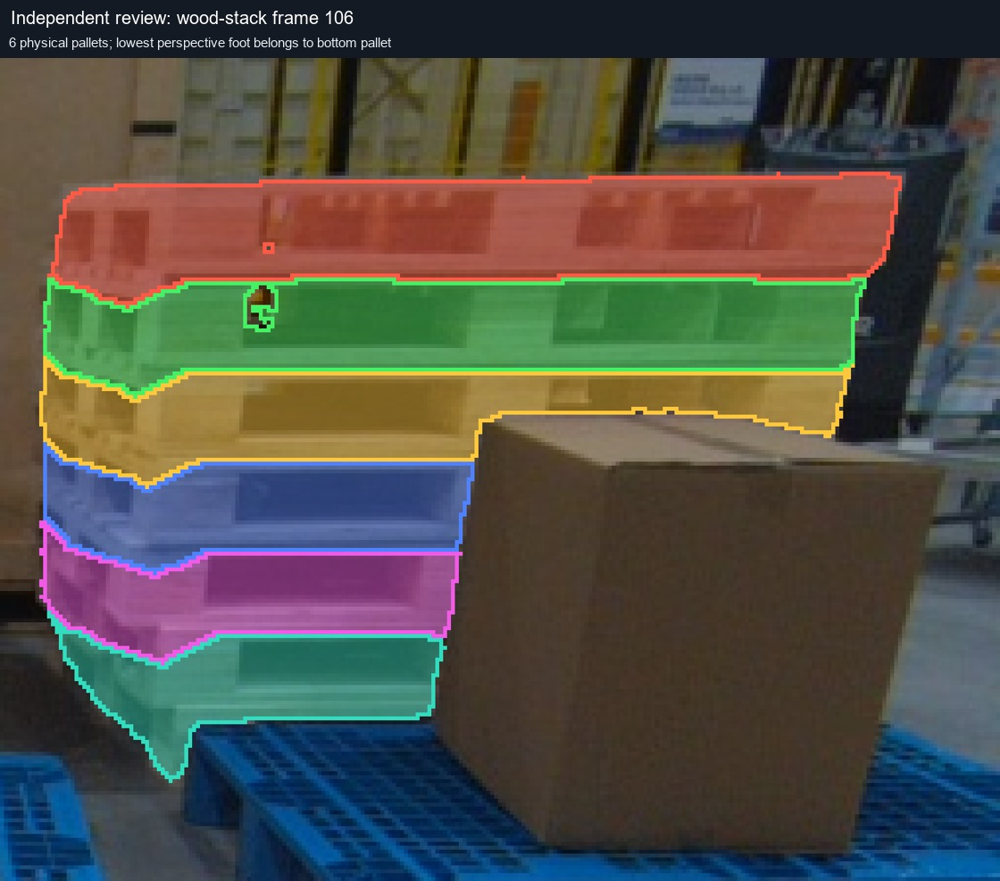
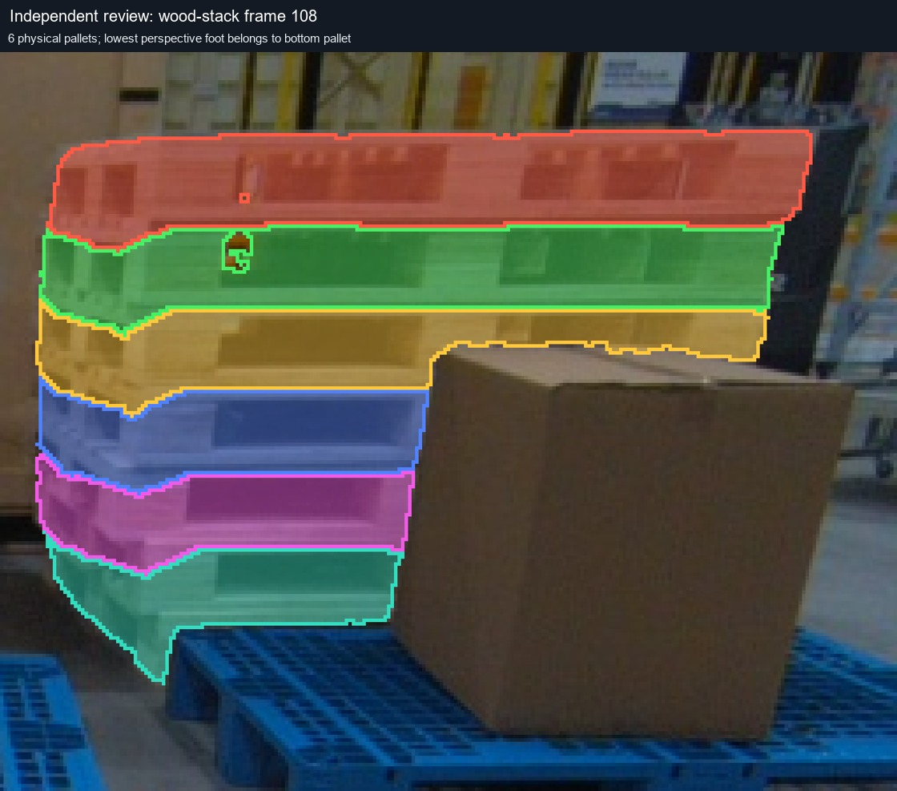
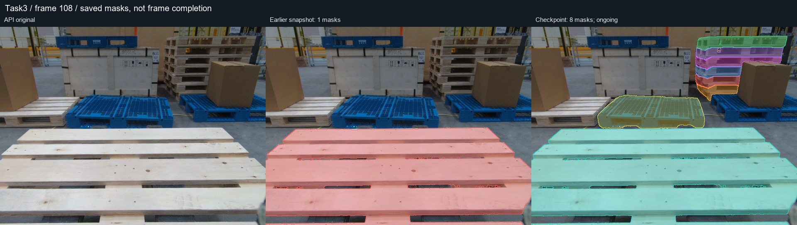
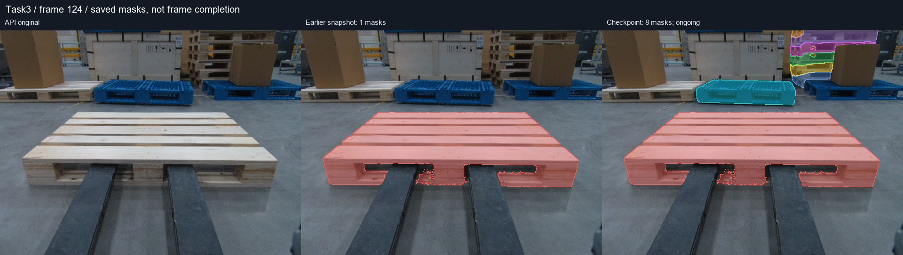
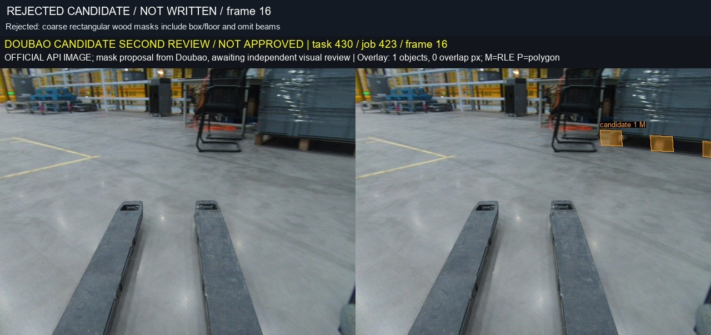

# Task3 标注中间报告：全图托盘、跟踪与独立复核

本报告记录 **2026-10-26 16:48:22（Asia/Shanghai）** 的阶段快照。范围为 **Task3 / task 430 / job 423，共 150 帧（0–149）**。任务仍在进行，尚未验收全帧全部类别。

## 1. 已完成什么，数字代表什么

| 指标 | 本次快照 | 含义与限制 |
|---|---:|---|
| CVAT 已保存 mask | 204 | 包含保留的 81 个 manual 和 123 个 auto；不是全部已审核 |
| 至少有一个标注的帧 | 103 / 150 | 只说明非空，不能算全图覆盖率 |
| 本轮经独立复核并回读验证的操作 | 123 | 108 次新增、15 次更新；每次均有写前状态与写后证据 |
| 已独立确认全图全部类别完成的帧 | 0 | 不把局部实例合格提升为整帧完成 |
| 当前已写入类别 | pallet（201） | 其余六类尚未在本轮提交 |

机器可读依据：[checkpoint.json](../../results/reviewed-workflow/2026-10-26/checkpoint.json)、[逐批操作账本](../../results/reviewed-workflow/2026-10-26/operation-ledger.json)、[实际审核操作及 RLE](../../results/reviewed-workflow/2026-10-26/reviewed-operations.json)、[保存状态快照](../../results/reviewed-workflow/2026-10-26/saved-annotations-snapshot.json)。快照仅记录当时状态，不随线上编辑自动改变。

仓库旧报告中的“492 个 shape / 116 帧 / 约 4.6 分钟”是历史传播产出，**不是质量验收或完成证明**。本轮发现了实例拆错、多个托盘合并、将箱体和地面纳入托盘、漏掉远处托盘等问题。历史结果可用于比较和失败分析，不能直接恢复为正确标注。

## 2. 用户规则落实到操作

1. 只写 Task3 对应的 task 430 / job 423；其他任务只作类别参考。
2. pallet 要找全图所有可见实例，包括远处、边缘、局部遮挡和堆叠托盘。货箱、地面、遮挡物不能归入托盘。
3. 一个物理托盘一个实例；被遮挡后剩余的可见碎片可以属于同一个 mask。下横梁与透视侧脚不能误拆成新托盘。
4. 用户对 17、19、21、23 帧的手工修改已经完成，现已允许**保留现状后增量补标**。恢复工作前仍需读取最新状态，不用旧快照覆盖。
5. pallet 全图审核完成后，按参考样例继续 person、floor、slope、ego、other_robot、cargo_floor。当前不宣称这些类别完成。

## 3. 图像证据：从近处一个实例到全图补标

三联对比图依次为 API 原图、较早保存状态、本次快照。颜色仅用于区分实例；图中的数量是保存数量，不是完成率。图像绑定记录见 [image-bindings.json](../../results/reviewed-workflow/2026-10-26/image-bindings.json)。

### 帧 100：补左木托盘、中央空蓝托盘、右侧载货蓝托盘和后方木垛


早期仅有近处木托盘。本轮补入 8 个可见实例，快照为 9 个。后方木垛按物理接缝确认为 5 个可见托盘；最下方横梁与侧脚属于同一物体，没有另计一个实例。货箱遮挡区域保持排除。

### 帧 104：补齐这一轮识别到的地面实例与上方托盘



该帧也是后续跟踪的人工复核种子。中央空蓝托盘、右侧载货蓝托盘、左木托盘、木箱上方蓝托盘需要保持各自身份。不能因为远处边缘接触而合为一个长条 mask。

### 帧 75：灰箱下的木托盘与箱体分离



这类目标宽而扁，粗矩形很容易包含箱体或地面。候选必须同时覆盖托盘上板、横梁、脚和可见斜侧面，并排除明确可见的背景。

### 帧 106 / 108：木垛每层独立，遮挡与孔洞逐一检查





两帧各 6 个物理托盘，均已独立复核并写入。下方四层部分被箱子遮挡，写入时设置 occluded=true；上方两层为 false。叉孔内的暗色有时是托盘背部材料，不能把所有暗色都挖空；明确露出的背景孔才排除。



这张全图也展示了中间状态的限制：部分其他实例候选仍在队列中。木垛通过不等于该帧全部托盘已完成。



110–124 所属连续区间的 8 帧新增 48 个木垛实例，均完成独立复核与回读。上层逐渐出画时只保留可见部分，层身份保持不变。

## 4. 跟踪怎样加速，怎样避免错用

### 先恢复真实时序

150 个逻辑帧混有多个连续采集片段。依据源文件时间戳排序，并在时间差超过 3 秒或源序号增量不等于 6 时断开，得到 4 个保守连续区间，长度为 62、20、23、45。

例如连续区间中的一段是 `100 → 102 → 104 → 106 → 108`，不是按逻辑帧 `100 → 101 → 102` 传播。另有两个看起来相似的区间相隔约 29 秒，不能越过间隔接着跟踪。这里确认的是连续采集区间，未声称已证明物理录像文件身份。完整顺序见 [sequence-manifest.json](../../results/reviewed-workflow/2026-10-26/sequence-manifest.json)。

### 本轮实际采用的路线


部署发现中可用的是 SAM2 **interactor**，没有发现已部署的 `kind: tracker`。因此本轮是本地光流辅助 + SAM2 精修的候选工作流，不是已经部署成功的 CVAT 原生视频 tracker，也没有把 SAM2 当作跨帧身份识别器。

104 帧中央空蓝托盘传播到 106、108 的一次候选生成耗时 **1.642 秒**，推理阶段没有提交 annotation PATCH 或异步标注请求。这个时间只包含该次候选生成，**不包含人工/Agent 复核、修边、写入和整段任务耗时**。两次 SAM2 与光流的 IoU 约 0.984 / 0.980，仅表示两个候选的自洽度，不是与人工真值的准确率。原始指标见 [tracking-104-108-evidence.json](../../results/reviewed-workflow/2026-10-26/tracking-104-108-evidence.json)。

### 已发生并被拦截的失败

| 情况 | 观察到的问题 | 本轮处理 |
|---|---|---|
| 75 → 78 灰箱木托盘 | 光流一致性接近零 | 停止这条传播，分别重新提示分割 |
| 91 → 93 木托盘 | 数值检查通过，但跳到邻近的另一个托盘 | 作者复核退回，重新建身份与候选 |
| 125 → 126 中央蓝托盘/木垛 | 视角变化大，一致性明显失败 | 停止传播，重新选种子；不强行延伸 |
| 木垛水平分层 | 将底部横梁或侧脚误拆成独立托盘 | 按原图接缝重新合并物理实例 |
| 灰箱下木托盘粗框 | 包含箱体和地面，漏掉横梁/脚 | 退回重分割，未将该旧版写入 |



失败图只作反例，不能用于模型训练真值。未知区域不由生成式图像工具补画，也不凭历史 shape 数强行凑齐实例。

## 5. 多 Agent 与豆包分工

| 角色 | 产出 | 写权限安排 |
|---|---|---|
| 豆包已有会话 | 指定帧候选、提示分割、作者自查 | 只产候选 |
| 并行候选 Agent | 按时间区间/对象类型生成、修正并追踪实例 | 只产候选 |
| 独立复核 Agent | 原图、遮挡、物理层数与边界核对，报告反例 | 只读与本地结果 |
| 指挥/最终复核 | 第二遍逐图审核、批准内容哈希、提交并回读 | 唯一自动写入者 |

“作者说通过”不会自动变为写入授权。作者冻结准确的候选文件哈希，复核者看对应原图和覆盖图。发现错分、错对象或不确定边界就退回；没有通过独立复核的候选保留为 pending。

## 6. 写入账本与保护手工编辑

| 批次 | 帧 | 回读验证操作 | 内容 |
|---|---|---:|---|
| 01 | 101、111 | 2 | 1 新增，1 更新 |
| 02 | 103、105、128、129 | 4 | 新增；107、109、149 因现场状态变化跳过 |
| 03 | 51、62、107、109、149 | 5 | 重新绑定当前状态后更新 |
| 04 | 53、55、57、59、61、63、64、65、67 | 9 | 已有 mask 修正 |
| 05 | 100 | 3 | 地面托盘 |
| 06 | 25 | 1 | 截断蓝托盘可见部分 |
| 07 | 102、104、106、108 | 10 | 地面/上方蓝托盘及首轮跟踪 |
| 08 | 75 | 3 | 灰箱下木托盘 |
| 09 | 100、102、104 | 17 | 按物理层数拆分的木垛 |
| 10 | 110–125 所属连续区间的 9 帧 | 9 | 中央空蓝托盘跟踪复核 |
| 11 | 106、108 | 12 | 六层木垛与遮挡属性 |
| 12 | 110、112、114、116、118、120、122、124 | 48 | 木垛逐层跟踪、修边与遮挡复核 |

写入流程先获取当前 annotations，比较目标帧全部 shapes/tags 的内容哈希。若有人新增、删除、换 ID 或改变属性，就跳过冲突帧；同帧多实例之间只接受本流程刚刚验证过的变化。每次请求只 PATCH 一个 shape，并验证其他实例和标签保持一致。不使用全量 PUT，不用旧文件覆盖整个任务。

若请求超时且不知道是否已生效，流程停止并保留锁与证据，先读取服务器查明结果，不能盲目重试。当前服务的 version 不能当作已验证的原子 CAS，因此读与写之间仍有竞争窗口；单写入者、逐帧哈希和回读能缩小风险，不能宣称完全消除了并发竞争。

另外，run 根目录的 `annotations_before/after.json` 是写入前的稳定性双读，**最后一个 `step_*/after.json` 才是该批最后一次已验证写后的状态**。本报告构建器使用后者，避免将预检快照误报成最终结果。

## 7. 后续可复用范式

可执行工具与命令说明放在 [workflow/](../../workflow/README.md)。新项目只改配置与标签映射；身份验证从环境变量读取，不复制当前机器路径或内部地址。

每轮保留以下最小产物：

```text
run/
  scope-and-config.json        # task/job/label、图像尺寸与禁止编辑帧
  baseline/                   # 当前标注、元数据、原图哈希
  sequence-manifest.json       # 源时间连续区间
  candidates/                 # RLE、提示点、原图绑定、推理指标
  reviews/                    # 作者意见、独立复核、拒绝原因、批准哈希
  write-plan.json             # 待写动作、目标帧预期哈希
  steps/                      # 每次写前/写后证据及结果
  report/                     # 前后对照、失败案例、统计、剩余项
```

复用顺序：**绑定范围 → 备份现状 → 确认时序 → 少量种子 → 小批候选 → 第二遍复核 → 只提交已批准增量 → 回读 → 发布阶段证据 → 下一批**。一个类别完成的标准是所有目标帧经过全图查漏与边界审核，而不是生成量达到某个数字。

建议每次 GitHub 阶段更新都固定一个快照时间，保存候选/操作/图像哈希，并用文件清单验证图文对应。新批次另起快照，不能悄悄把已发布报告的数字改成另一个时间点。

可复用工具包已在独立复核中通过 **32 项离线测试**，覆盖任务/标签绑定、保护帧释放、真实时序断段、RLE 编解码、重复实例、并发修改、响应丢失不重试和禁止全量替换等。CLI 帮助可运行。真实服务器的 123 次写入使用本轮任务专用版本；新配置化 CLI 的测试不应被表述成在所有 CVAT 版本上完成端到端验证。

## 8. 当前剩余项

- 继续审核并写入其他远景、画面边缘、后方堆叠与载货托盘候选。
- 按用户新授权恢复 17、19、21、23 帧增量补标。
- 木垛 110–124 已完成本批 48 个实例回读；125 及后续新视角候选仍需最终复核。队列产量不计入保存数量。
- 对早期已保存 mask 的 occluded 属性继续复查，几何通过不代表元数据全部验收。
- 完成所有帧 pallet 全图查漏后，推进 person、floor、slope、ego、other_robot、cargo_floor。
- 最后进行跨帧身份与全图漏标复核，才报告整体完成。

本报告的图片和结构化证据有 [SHA256 产物清单](../../results/reviewed-workflow/2026-10-26/asset-manifest.json)。[构建脚本](tools/build_task3_checkpoint.py)从本地原始审核证据重建公开快照；它不调用远程接口、不写标注。
