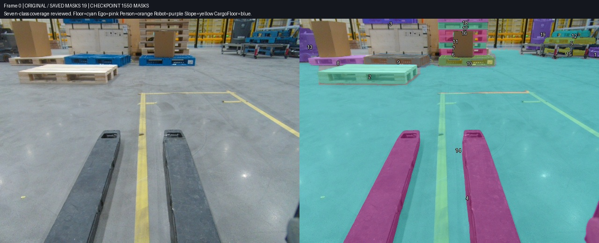
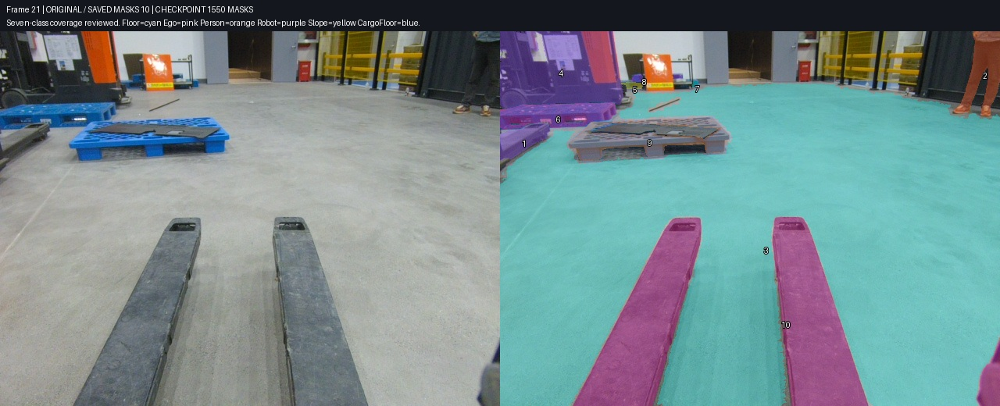
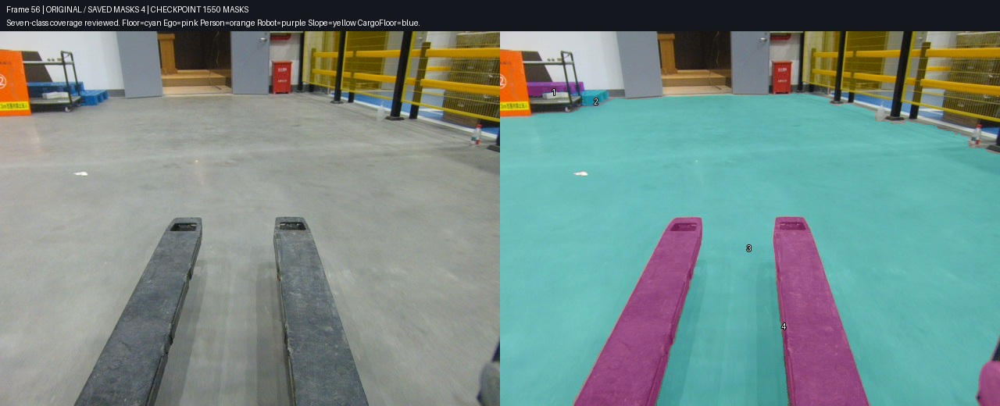
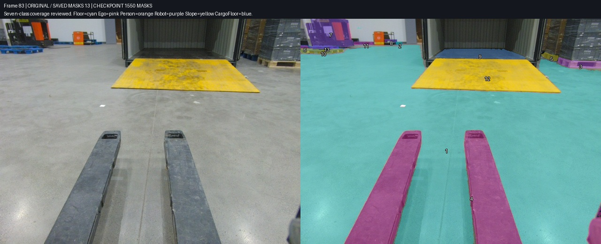
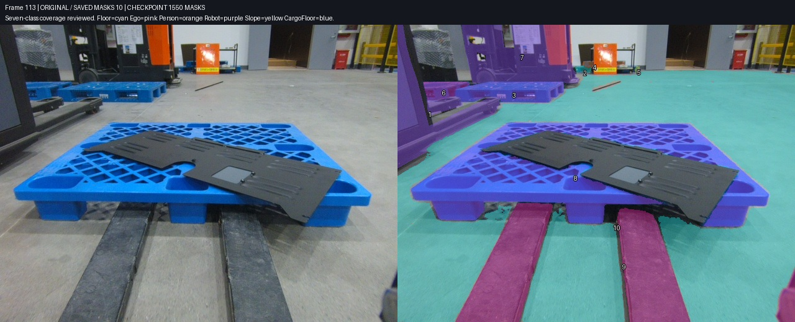
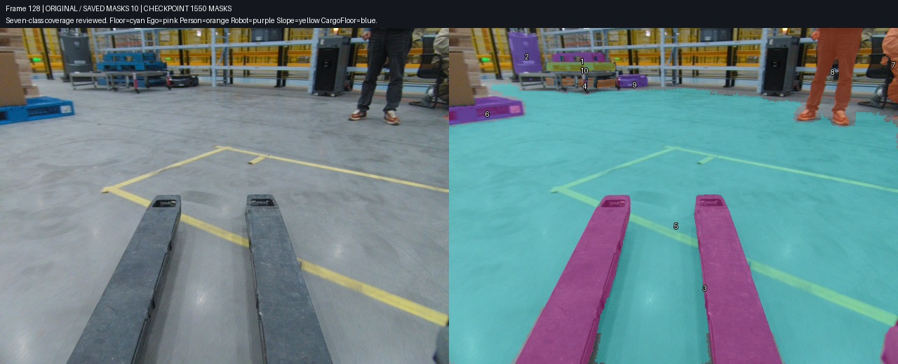
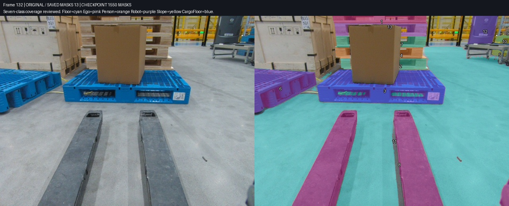
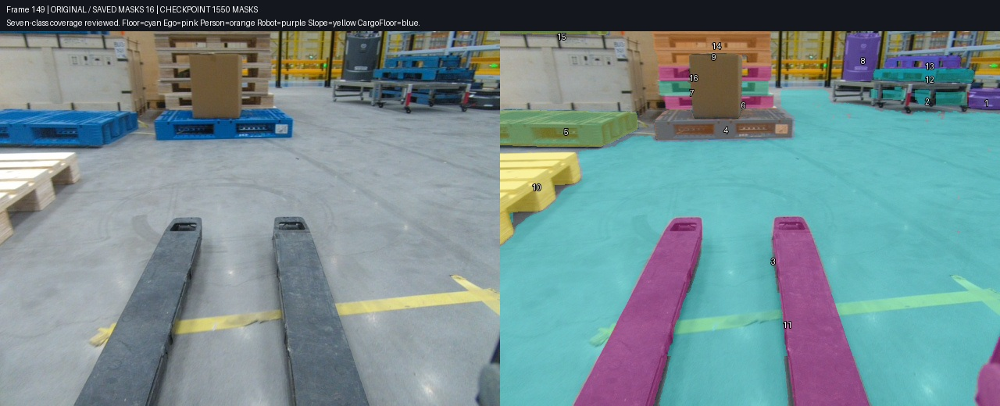

# Task3：150 帧七类分割完成记录

本报告固定在 **2026-10-27 凌晨第 79 批最终回读**。Task3 为 task 430 / job 423，150 帧按用户确认的实用精度完成七类可辨识目标的全图覆盖复核，共保存 **1,550 个 mask**。检查重点为完整实例、正确类别、物理层数、明显遮挡与主要边界；没有继续反复打磨 1–2 像素。

依据：[最终状态](../../results/reviewed-workflow/2026-10-27-final/checkpoint.json)、[实际保存标注](../../results/reviewed-workflow/2026-10-27-final/saved-annotations.json)、[逐批操作账本](../../results/reviewed-workflow/2026-10-27-final/operation-ledger.json)、[七类覆盖记录](../../results/reviewed-workflow/2026-10-27-final/all-classes-coverage-review.json)。快照 SHA256 为 `f0cdcd2ca102da58977ffa0595e74985b9b5ff5bafdbc10a40843d3a5760f971`。这是本任务口径下的实用覆盖结论，没有额外真值集测得的准确率或召回率。

公开上传已获授权，但先前 GitHub 写入返回 403，用户要求先继续标注。**本材料在本地整理提交，尚未成功推送 GitHub，也没有创建 PR。**

## 保存与核对结果

| 类别 | 保存实例数 |
|---|---:|
| pallet | 1006 |
| person | 16 |
| floor | 150 |
| slope | 8 |
| ego | 150 |
| other_robot | 215 |
| cargo_floor | 5 |

150 帧都有 ego 与 floor；未出现的类别不虚构 mask。pallet 包含远处、边缘和遮挡后可辨识的独立托盘，共 1,006 个；第 27、29 帧没有可辨识托盘。细网格整体保留，只扣明显大孔；运输木箱一体支脚不计为托盘。橙色“02”旁上下两个蓝色结构按两个物理托盘处理。

累计 **1,534 次逐实例回读验证**，包括 1,454 次新增、80 次同 ID 更新，分 79 批完成。来源字段保留 81 个 manual 和 1469 个 auto；来源字段本身不表示质量。最后新增的 71 个机器人逐项绑定冻结 mask、批准载荷与已存 ID；此前 1,479 个实例全字段保持不变。

最终检查覆盖全部 150 帧的源图摘要、RLE 解码与边界、非空像素、唯一 ID、重复 mask、逐帧类别数量及全部实例像素交叠。未发现新增跨类交叠或结构错误。第 75 帧已有托盘间 5px、第 102 帧已有托盘间 1px 接触作为实用边界容差保留，并锁定原几何。可检查脱敏的[逐帧审核明细](../../results/reviewed-workflow/2026-10-27-final/coverage-review-detail.json)与[结构及交叠审计](../../results/reviewed-workflow/2026-10-27-final/final-structure-audit.json)；原本机证据路径已替换为相对证据名，文件不包含认证信息。

第 50、62 帧极左蓝角、第 79 帧疑似一体箱底木条、第 84 帧边缘人物/椅子难辨片段有明确排除记录；没有把身份不足的小碎片强造为实例。

## 八张实际保存状态图

左为原图，右为最终已保存 mask。主控实际查看了以下八张导出图，确认与本轮源图及保存状态对应。floor 为青色、ego 为粉色、person 为橙色、other_robot 为紫色、slope 为黄色、cargo_floor 为蓝色；pallet 用不同颜色区分实例。图像、原图摘要与展示 ID 见[图像绑定](../../results/reviewed-workflow/2026-10-27-final/image-bindings.json)。

### 第 0 帧：全图盘点与跨视角回查



近处、后方木垛、箱顶及货架托盘逐层分开；后段确认灰色升降机器人和低矮 AMR 身份后，回查前段并补上可见实例。

### 第 21 帧：保留人工结果并补齐类别



人物、托盘、地面、自机和其他机器人分别标注。增量补标以当时的新鲜基线为准，手工对象保留原 ID。

### 第 56 帧：独立托盘身份



橙色“02”附近上方带叉孔的蓝结构与右下蓝盘按用户明确口径分成两个独立托盘。

### 第 83 帧：仓库地面、斜坡与箱内地板



仓库 floor、入口黄色 slope 和集装箱内 cargo_floor 分开；不能把普通黄色地面标线当成斜坡。

### 第 113 帧：同一车辆的断开可见部分



左侧车辆的车身和两条叉臂归同一 other_robot，后方黑橙车辆另算。最终车叉候选曾撞上已存 floor；查原图确认灰地阴影被多包后，仅修候选。

### 第 128 帧：低矮 AMR 与画面边缘人物



审核曾否决选到地面或托盘的 AMR 候选，修到实际可见机器人主体；边缘人物只标可见部分。

### 第 132 帧：独立木托盘与大叉孔



独立木托盘与运输木箱一体箱底区分；手工托盘明显叉孔地面曾以同 ID 做局部修正，保留来源和其他元数据。

### 第 149 帧：末帧也纳入完整盘点



末段同样检查远处机器人、遮挡托盘、地面和自机；不能把每帧非空或传播结束当成全类别完成。

## 中间问题与修正方式

- **传播会换到邻居。** 光流和 SAM2 数值门槛通过也不能证明实例身份；木托盘堆叠仍需按物理层逐帧审核。被否决候选保留，不自动写回。
- **语义漏项需要回查。** 后段源图确认窄灰色升降单元是机器人后，前段 0、2、4、6、8、10、12、14、16 共补 18 个机器人。库存数量和旧清单相符，仍可能共同漏掉一种身份。
- **大边界错误仍修正。** 104、106、108 的灰色机器人漏掉主体；128、148、149 的低 AMR 曾定位错误；黑橙车门架曾漏分。这些修后单独交审，已通过部分先保存。
- **交叠检查不能替代看图。** 最后 113、115、117 的新车叉候选分别误包 494、1,351、182px 灰地/阴影。写前检查拦下整批，原图双审确认后只改候选，保留既有 floor。旧“通过”回执保留并标为被新版取代，未把旧判断悄悄改成正确。
- **人工修订保留身份。** 获授权的局部改边用原 ID update，保留 source 和其他元数据；不复制新实例替代旧实例，不做整任务 PUT。

用户将精度调整为实用标准后，停止细碎像素返工，把时间用于明确缺失的实例、类别与大边界。上述问题影响对象身份或主体覆盖，仍在写入前处理。

## 后续可复用的执行范式

1. 绑定唯一 task/job、类别映射、授权范围和新鲜基线；原图和标注分别留摘要。
2. 先明确独立实例、孔洞、遮挡和画外部分口径，盘点全幅图像，再决定哪些连续片段适合传播。
3. 按帧段分配作者，另一位审核者看原图与最终叠图；不同作者、复核与已通过部分的写入并行推进。
4. 冻结通过的小包。主控是唯一自动写入者：检查当前帧全部内容摘要，每次只 PATCH 一个 shape，立即回读核验；外部改动或未知结果先停该项查明。
5. 结束时把源图清单、冻结候选、批准载荷与已存 ID 串起来，逐帧核对七类数量和覆盖；保存覆盖结论时绑定该帧所有实例内容摘要。
6. 从固定写后快照生成图文；实际查看每张导出图，验证图像绑定、文件摘要和相对链接后再发布。

本次使用三个帧段作者与跨作者复核，主控统一写回。豆包历史记录作为参考；本阶段没有可靠的新实时豆包调用回执，不把其他 Agent 的工作描述成豆包已执行。

现有可复用路线是 **DIS 光流运输提示点 + 每帧 SAM2 提示分割**，不是已验证的视频记忆 tracker。源数据含交错视频和时间断点，必须按真实源序列分段，不能按相邻逻辑帧号盲目跟踪。默认小段传播、逐帧身份审核，可靠时才继续；[工具包与命令](../../workflow/README.md)给出完整配置、候选生成、审核、写入与失败恢复。33 项既有离线测试通过，覆盖任务边界、并发改动、失联停写、RLE 与手工元数据保护；不代表所有服务器版本的端到端保证。

## 固定快照重建与核验

```powershell
python docs/reports/tools/build_followup_checkpoint.py --evidence-root <本地证据目录> --through-run plan_20261026T175625028024Z --tag <新的输出标识> --frames 0 21 56 83 113 128 132 149 --pallet-coverage-complete --all-classes-coverage-complete
python docs/reports/tools/validate_followup_checkpoint.py --checkpoint-dir results/reviewed-workflow/<新的输出标识> --report docs/reports/2026-10-27-task3-final.md --report README.md
```

构建器保留原回读 JSON 字节，最终覆盖记录必须与该快照摘要相同，不能借用别的阶段的“完成”标记。新导出图先标 PENDING，实际看过后才能登记 PASS 并更新[产物摘要清单](../../results/reviewed-workflow/2026-10-27-final/asset-manifest.json)。验证器检查字节摘要、计数、账本、图像 ID 绑定、本地链接及常见敏感模式，不代替视觉审查。

历史固定记录继续保留：[第57批](2026-10-26-task3-batch57.md)、[第42批](2026-10-26-task3-batch42.md)、[初始204个mask](2026-10-26-task3-reviewed-workflow.md)。后续修改应生成新的快照与报告，不覆盖这里的统计。
