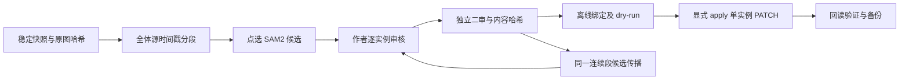

# 可复用的 CVAT 双审增量标注流程

这套工具把候选生成、审核和远端修改分开。SAM2 只返回候选 mask；默认计划命令完全离线。只有带 `--apply`、绑定审核摘要的计划会向指定 Job 发送单个实例的 PATCH。不会发送全量 PUT，也不会调用异步自动标注接口。

本目录是从实际标注过程整理的配置版。**33 项离线测试通过；配置版未对另一个真实服务做写入验证。** 使用前先核对自己的 CVAT/SAM2 合约，并按小批候选、双审、增量写回推进。



## 1. 配置和认证

需要 Python 3.10+。在仓库根目录运行：

```bash
python -m pip install -r workflow/requirements.txt
python -m unittest discover -s workflow/tests -v
python -m workflow --help
```

复制 `workflow/config.example.json` 为 `workflow/config.local.json`，填入实际信息：

- `base_url` 必须是同一 CVAT 服务的 origin，不含账号、密码、路径或查询参数。
- `task_id`、`job_id`、`labels` 是明确白名单；每次命令用 `--label` 选择一个标签。
- `frame_count`、`width`、`height` 必须与 Job 元数据一致。
- `function_id` 是已验证仅返回 mask 的同步 interactor；运行时还会检查部署模型的 `kind=interactor`。服务器自定义函数的内部副作用无法由客户端证明，不能把未知函数直接当作纯推理接口。
- `work_dir` 和 `images_dir` 相对**配置文件所在目录**解析。示例运行结果在被忽略的 `workflow/work/`、`workflow/frames/`。
- `protected_frames` 用于当前人工编辑区。它是可释放的协作锁，不是永久排除名单。例如人工完成 `[17,19,21,23]` 并明确允许增量补标后，可将这些帧从配置中删除，再取新快照；保留已有人工实例，并由整帧哈希继续拦截并发修改。

认证只从进程环境变量读取：优先 `CVAT_TOKEN`，否则使用 `CVAT_USERNAME` 和 `CVAT_PASSWORD` 内存登录。通过本机安全的环境注入方式设置；不要把实际凭据写进配置、命令历史、脚本、报告或 Git。工具不读取任何旧聊天、账号文件或浏览器会话，也不保存 token。

该版本有意只支持**从逻辑帧 0 开始、连续覆盖整个 Job、无 frame_filter/deleted_frames、统一图像尺寸的 mask image job**。不符合时拒绝运行。非零起始 Job、CVAT tracks 和跨标签的一份混合修改计划尚未支持。

## 2. 建立只读基线和原图映射

```bash
python -m workflow --config workflow/config.local.json --label pallet snapshot --out workflow/work/baseline --download-frames
python -m workflow --config workflow/config.local.json --label pallet sequence --baseline workflow/work/baseline --out workflow/work/sequence.json
```

快照两次读取 annotations，保存任务、Job、标签及帧元数据；两次不一致则失败。下载使用 Job 的逻辑帧编号，`image_manifest.json` 把每个原图的 SHA256 绑定到 CVAT 的源文件名和元数据摘要。已有图片不被覆盖；部分下载失败后使用新的图片目录重新运行。

默认时间分段会解析**每一帧**的源文件名，按真实时间戳排序，遇到时间间隔或源编号步长异常就断开。不能用逻辑帧的奇偶数推断视频序列。文件名不含时间戳时，可由人工验证后配置：

```json
{"mode":"explicit","runs":[[1,3,0,5],[2,4]]}
```

显式分段必须恰好覆盖所有逻辑帧一次；不会跨段传播，也不会越过受保护帧。

## 3. 生成纯推理候选

复制并编辑 `prompts.example.json`；坐标是原图像素坐标，不能用放大显示坐标。

```bash
python -m workflow --config workflow/config.local.json --label pallet infer --baseline workflow/work/baseline --prompts workflow/prompts.example.json --out workflow/work/candidates
```

每个实例保存正负点、请求、压缩响应、官方 CVAT RLE、原图哈希、全图 overlay 和放大原图对照。所有结果都是 `PENDING_AUTHOR_AND_INDEPENDENT_REVIEW`。推理前后还会只读比较 annotations；发现变化只报告观察结果，不会把外部人工修改归因于推理工具。

候选可以同帧多实例，但实例名必须唯一。SAM2 返回多个候选时，必须先明确选择一个实例 mask，不能整批默认认可。

## 4. 双审、绑定和增量写回

作者逐帧核对实例身份、完整轮廓、遮挡、脚间地面、孔洞、载荷及相邻目标；独立审核者再看原图与 overlay。审核应覆盖整幅图所有目标，shape 数增加不等于实例召回完成。

审核后创建 `workflow/work/reviewed-index.json`，格式见 `reviewed-index.example.json`，填写不同作者/审核者名称及**精确候选文件 SHA256**。审核名称是审计记录，不能代替服务账户授权；程序不能证明某人确实看过图片。

```bash
python -m workflow --config workflow/config.local.json --label pallet bind --baseline workflow/work/baseline --reviewed-index workflow/work/reviewed-index.json --out workflow/work/reviewed-plan.json
python -m workflow --config workflow/config.local.json --label pallet plan --baseline workflow/work/baseline --candidate workflow/work/reviewed-plan.json
python -m workflow --config workflow/config.local.json --label pallet plan --baseline workflow/work/baseline --candidate workflow/work/reviewed-plan.json --apply --out workflow/work/apply-001
```

`bind` 只生成 create 计划，且本身不联网。需要 update/delete 时，明确编写 `changes` 并指定精确 `shape_id`，按同样摘要审核流程处理。局部几何修正保留原 ID、source 和其他元数据，人工标注不会被改成 auto。`occluded` 可显式设置为布尔值；create 默认 false，update 未指定则保留原值，delete 不接受该字段。

写入约束：

- 每次只有一个 shape 的 `PATCH ?action=create/update/delete`，同帧多个目标按顺序处理。
- 基线文件、任务/Job/标签/尺寸、源图、审核摘要均绑定；修改候选后审核摘要失效。
- 同帧所有 shape 的 ID、几何、属性、source 和 tags 都进入哈希。人工增删改或 ID 重排都会阻止旧基线覆盖该帧。
- 只在自己的写入已回读验证后更新该帧期望哈希；检测到外部变化则跳过该帧后续修改。
- 相同像素的重复 mask 被离线拒绝，即使 RLE 或包围框填充写法不同。近似重叠或错误的实例身份仍要靠视觉审核。
- 写前保存完整备份和 intent。超时、丢失响应、回读异常都停写，不重试、不自动回滚，并保留 `incremental_apply.lock`。

未知结果应先只读核对远端、intent 和备份，确认已提交的实例及其他变化，重新建立基线和计划后才释放锁。不要直接删锁后重跑原计划。CVAT 未提供本流程已验证的原子“比较并交换”合约：最终 GET 和 PATCH 之间仍存在竞态窗口。保持一个远端写入者，并让人工编辑区受保护；哈希和回读能够拦截/发现许多冲突，但不能宣称绝对无竞态。

## 5. 同段候选传播

对已双审的种子 mask 按 `seed-review.example.json` 填写源图、mask 摘要和实例身份，然后运行：

```bash
python -m workflow --config workflow/config.local.json --label pallet propagate --baseline workflow/work/baseline --seed-frame 0 --seed-mask workflow/work/candidates/frame_000000_pallet_1/mask_00.png --seed-review workflow/work/seed-review.json --steps 8 --instance-key pallet_1 --out workflow/work/propagation-001
```

这是 **DIS 光流运输提示点 + 每帧同步 SAM2**，不是具有视频记忆的 SAM2 tracker。流不可靠、目标出画、分割偏离过大时停止；最多一次请求 25 个后继帧。默认建议每批 8 帧，逐实例、逐帧看对照图后再续跑。

实测教训必须保留：

- 一次相邻木托盘传播在数值门槛通过后，SAM2 仍从目标托盘换到邻居。IoU 和光流可靠率不能确认身份。
- 浅色木板会被漏分，纯光流会把边缘扩到地面；这种情况应局部补点或人工修正，并重新二审，不能降低阈值硬追。
- 堆叠木托盘可能被合成整堆。必须按真实物理层分实例，不能把一条可见板条当成一个完整托盘。
- 背景从叉孔可见时应排除；暗色内部格栅、前景遮挡和脚间地面需要依任务规范区别处理。

本工具不会把这些风险自动标记为“审核通过”，也不默认启用未经复核的颜色填补、孔洞填充或层切分。

## 6. 全图缺口与不确定性记录

每帧都应维护一份覆盖表，格式参考 `coverage.example.json`。把当前已存对象、作者审过的候选、已知漏项、身份不明项及两位审核者分开记录。非空帧数不等于全图完成帧数，空帧也不能自动当作没有目标。只有两位审核者看过全幅原图，并确认所有可见目标均处理且没有未决项，才能把该类别的覆盖状态改为 `COMPLETE`；整项任务完成还要求每个类别满足此条件。覆盖表是人工审计格式，当前 CLI 不会自动生成或验证其结论。

将全幅原图、候选叠图、局部放大、必要的修订差异图一起保存。实例身份判断应考虑近处、边缘、远处、堆叠和被遮挡处；被遮挡后分散的可见片段可能仍属于一个物理托盘。跨视角证据可以帮助判断身份，但不可把另一视角的像素位置直接套用。

叉孔材料判断采用以下顺序：先定位确切孔口，再核对原图材质及前后遮挡关系；只删除能确认的背景。蓝色内部支撑、木材内表面及印字属于物体。白色或黑色本身都不是背景证据。对强白反光、模糊暗条，记录 `UNRESOLVED_MATERIAL_RETAINED`，保留当前像素并等待更清楚的证据。已经写入的几何若需修订，使用当前快照下同一 ID 的 update，完整核对旧 shape，不创建第二个重叠实例。

修订日志应保留被否决版本、否决原因、修订差异及最终文件摘要。例如“同一托盘在近处可见灰色地面”不足以证明较远帧的白亮条也一定是地面。审核者发现这种推断越界时，应撤回不确定切除，标明未决点；不要把保守保留写成材质已确认。

## 文件与验证

`config.py` 管白名单和路径；`safe_incremental.py` 管快照、RLE、冲突和 PATCH；`inference.py` 管纯推理与证据；`sequence.py` 管全体时间戳分段；`propagation.py` 管候选传播；`__main__.py` 提供 CLI。

测试全部使用本地合成数据或 fake transport，不需要 token，不联网，不写 CVAT。覆盖多实例、精确 ID、重复像素、人工变化、元数据绑定、失联停写、保护帧释放、配置边界、序列断点及官方 SDK 的 RLE 往返。

主要合约来源：[CVAT Lambda API 实现](https://github.com/cvat-ai/cvat/blob/develop/cvat/apps/lambda_manager/views.py)、[CVAT 客户端 Lambda 管理器](https://github.com/cvat-ai/cvat/blob/develop/cvat-core/src/lambda-manager.ts)、[独立部署的 SAM2 Tracker 文档](https://docs.cvat.ai/docs/annotation/auto-annotation/segment-anything-2-tracker/)。部署版本可能不同，须以当前服务合约为准。
